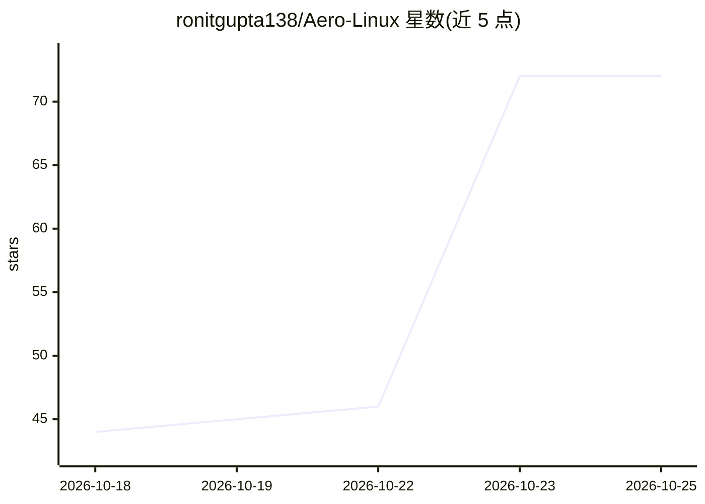

# ronitgupta138/Aero-Linux

⭐ 72 · Python · MIT · 推送 2026-10-17 · [GitHub](https://github.com/ronitgupta138/Aero-Linux) · [官网](https://ronitgupta138.github.io/Aero-Linux/) · 个人维护

**面向开发者的轻量 Linux 发行版：低内存占用并集成一键本地 LLM**

基于 Debian 的 Linux 发行版，面向系统程序员、后端工程师与本地 AI 构建者：空闲内存占用 312MB，使用 ZSTD 多线程 zRAM 压缩内存页面，提供双桌面模式（Windows 风格任务栏与 Sway 自动平铺）、电池充电阈值控制与风扇档位。AI 部分通过 aero ai 命令配合 Ollama 与 Docker 一键启动本地模型（如 deepseek-r1:8b），并自动配置 NVIDIA CUDA/AMD ROCm 内核，另提供 Aero Local AI Studio 离线模型管理 GUI。包含 59 个原生 GTK3 图形工具与 25+ aero 子命令，可通过 curl 安装脚本或源码构建 Live ISO。

## 筛选速览

| 维度 | 判定 | 备注 |
|---|---|---|
| AI 角色 | `ai-enhanced` | 去掉 AI 部分产品仍成立 |
| 许可风险 | `permissive` | MIT |
| 部署形态 | `None` |  |
| 模型依赖 | local-ok | 支持本地模型 |
| 硬件要求 | — | 无带数字的原话,不猜 |
| 安装摩擦 | `medium` | 含编译或系统依赖之一 |
| 成熟度 | — | 结构信号不足 |

## 能力要点

- 空闲内存 312MB，zRAM ZSTD 压缩（约 2.8:1 压缩比）
- aero ai 配合 Ollama/Docker 一键运行本地 LLM，自动配置 CUDA/ROCm
- 59 个原生 GTK3 图形管理工具覆盖开发与系统维护
- 双桌面模式：Windows 风格任务栏与 Sway 自动平铺

## 适用场景

- 在低配或 16GB 内存机器上运行本地 LLM 并保留可用内存
- 从 Windows 迁移的开发者获得熟悉的桌面操作习惯
- 不依赖终端完成系统维护与开发工作流

## 场景标签

 · 领域:操作系统/开发者工具

## 证据(README 行号)

> L64: ### 3. 🤖 Native Local AI Stack (`aero ai`)
> L29: *Engineered for systems programmers, backend engineers, and local AI builders. Sub-350MB idle footprint, dynamic in

## 星数曲线

2026-10-18 44 → 2026-10-25 72（+28）

---
*卡片 v1 · prompt 1.4 · 生成 2026-10-24 · 置信度 high · 依据 README sha `8cab741daaae` · [字段定义](../../DATASET.md)*
