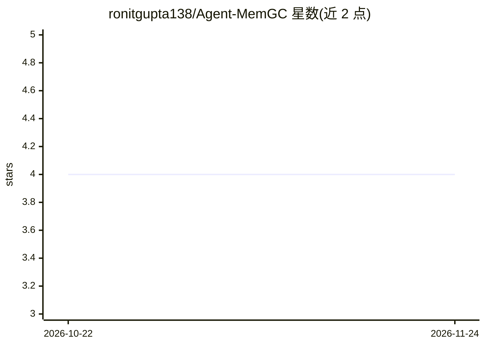

# ronitgupta138/Agent-MemGC

⭐ 4 · Rust · MIT · 推送 2026-11-23 · [GitHub](https://github.com/ronitgupta138/Agent-MemGC) · 个人维护

**为 AI agent 指令文件提供审计、清理与缓存优化的 Rust 工具**

面向开发者的 CLI 与 MCP 服务器工具，针对 CLAUDE.md、AGENTS.md、.cursorrules 等 agent 指令文件执行静态分析：检测已删除文件路径引用、识别语义矛盾规则、重排内容以保留 KV-cache 前缀命中、清除重复规则与临时调试笔记。提供 check/fix/stats 等子命令，支持 JSON 输出与 dry-run 预览，可通过 stdio MCP 服务器接入 Claude Desktop、Cursor、Hermes Agent。README 自述延迟 <15ms，token 缩减 35%–55%。

## 筛选速览

| 维度 | 判定 | 备注 |
|---|---|---|
| AI 角色 | `ai-ecosystem` | LLM/agent 周边工具 |
| 许可风险 | `permissive` | MIT |
| 部署形态 | `library` | 以包/库形式分发 |
| 模型依赖 | — | README 未给出锁定关系 |
| 硬件要求 | — | 无带数字的原话,不猜 |
| 安装摩擦 | `low` | 无编译、无系统依赖或容器化 |
| 成熟度 | — | 结构信号不足 |

## 能力要点

- 检测死文件路径引用与语义矛盾规则
- 缓存布局优化，避免破坏 Anthropic/OpenAI KV-cache 前缀命中
- 以 stdio MCP 服务器形式接入 Claude Desktop、Cursor、Hermes Agent
- 输出 JSON 结构化结果，可用于 CI/CD 门禁

## 适用场景

- 审计长期协作后劣化的项目指令文件
- 在 CI/CD 中对 AGENTS.md 做结构化检查
- 重排指令文件以保留 prompt cache 命中、降低 token 消耗

## 场景标签

`提示工程` · 领域:Agent 开发

## 证据(README 行号)

> L10: ### **The Linter, Cache-Layout Optimizer & Generational Garbage Collector for AI Agent Instructions**
> L21: **Audit, clean, and deduplicate your AI instructions. Detects dead file paths, resolves contradictory rules, and el
> L76: `agent-memgc` runs as a native stdio Model Context Protocol (MCP) server for **Claude Desktop, Cursor, and Hermes A

## 星数曲线

2026-10-22 4 → 2026-11-24 4（+0）

---
*卡片 v1 · prompt 1.4 · 生成 2026-11-21 · 置信度 high · 依据 README sha `2607851e22c5` · [字段定义](../../DATASET.md)*
