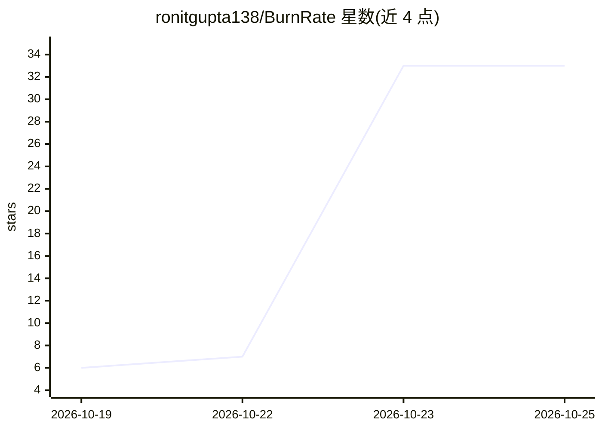

# ronitgupta138/BurnRate

⭐ 33 · Rust · MIT · 推送 2026-10-19 · [GitHub](https://github.com/ronitgupta138/BurnRate) · 个人维护

**面向 AI 编码代理的终端 HUD 反向代理：硬性预算与缓存泄漏告警**

以 Rust 编写的反向代理与 CLI HUD，开发者通过 ANTHROPIC_BASE_URL/OPENAI_BASE_URL 将 Claude Code、Cursor、Codex、OpenCode 等编码代理的流量指向本地代理，实时显示会话花费、token 燃烧率与 prompt-cache 健康度；可包裹任意代理命令实施硬性花费上限，超限终止失控重试循环。内置含 90% 缓存读取折扣的多模型定价表（Claude/GPT-4o/DeepSeek），并通过代理检测缓存失效。经 cargo 安装或源码构建。

## 筛选速览

| 维度 | 判定 | 备注 |
|---|---|---|
| AI 角色 | `ai-ecosystem` | LLM/agent 周边工具 |
| 许可风险 | `permissive` | MIT |
| 部署形态 | `library` | 以包/库形式分发 |
| 模型依赖 | locked-api |  |
| 硬件要求 | — | 无带数字的原话,不猜 |
| 安装摩擦 | `medium` | 含编译或系统依赖之一 |
| 成熟度 | — | 结构信号不足 |

## 能力要点

- 反向代理 + stderr 实时 HUD（花费/燃烧率/缓存健康）
- 硬性花费上限：burnrate run 包裹命令，超限终止
- prompt-cache 失效检测与告警
- 内置多模型定价表（含 90% 缓存读折扣）

## 适用场景

- 给 Claude Code/Cursor 等代理设硬性预算，防止失控烧钱
- 实时观察代理会话的 token 成本与缓存命中率
- 排查导致缓存失效的 prompt 变动

## 场景标签

`LLM 可观测性` · 领域:评测与运维

## 证据(README 行号)

> L21: A lightweight, zero-overhead reverse proxy and CLI HUD that gives developers absolute cost control and prompt-cache
> L30: `burnrate` acts as an in-line cost shield: a zero-latency reverse proxy and terminal HUD that monitors session spen
> L47: |               Coding Agent CLI (Claude Code, Cursor, Codex, OpenCode)             |

## 星数曲线

2026-10-19 6 → 2026-10-25 33（+27）

---
*卡片 v1 · prompt 1.4 · 生成 2026-10-25 · 置信度 high · 依据 README sha `7c853b3172c2` · [字段定义](../../DATASET.md)*
