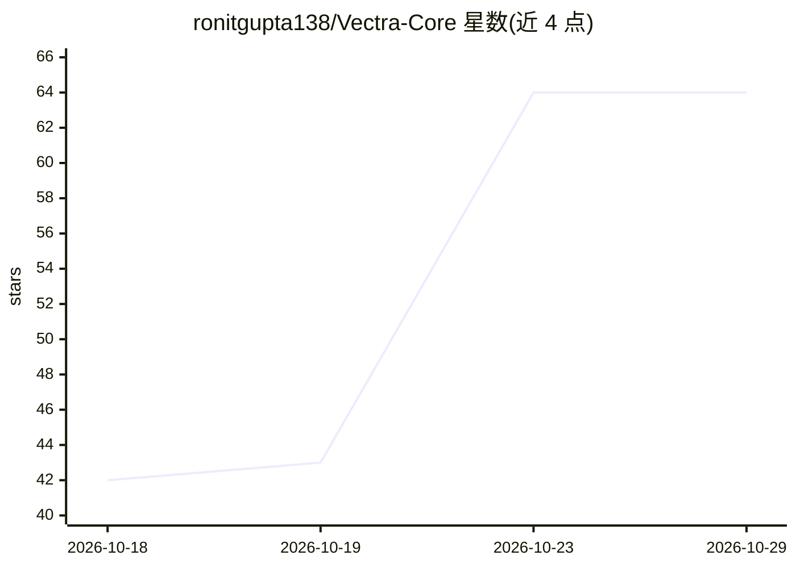

# ronitgupta138/Vectra-Core

⭐ 64 · Java · MIT · 推送 2026-10-20 · [GitHub](https://github.com/ronitgupta138/Vectra-Core) · 个人维护

**Java 21 实现的内存向量搜索引擎与 HNSW ANN 图索引**

零原生依赖的内存向量数据库与近似最近邻（ANN）搜索引擎，用 Java 21 Project Loom 虚拟线程构建。实现 HNSW 分层图索引、8-bit 标量量化（SQ8）、元数据谓词过滤，支持 Cosine/L2/DotProduct 距离；面向 128-1536 维嵌入提供 REST API（建集合、插入、KNN 检索）。README 给出在 AMD Ryzen 5 5600H 上的基准数据（16,949 QPS、p50 0.283ms），基准规模为 2,000 条 128 维向量。以源码克隆方式运行，MIT 许可。

## 筛选速览

| 维度 | 判定 | 备注 |
|---|---|---|
| AI 角色 | `ai-ecosystem` | LLM/agent 周边工具 |
| 许可风险 | `permissive` | MIT |
| 部署形态 | `None` |  |
| 模型依赖 | — | README 未给出锁定关系 |
| 硬件要求 | — | 无带数字的原话,不猜 |
| 安装摩擦 | `medium` | 含编译或系统依赖之一 |
| 成熟度 | — | 结构信号不足 |

## 能力要点

- 纯 Java 21 实现 HNSW 图索引（多层跳图 + beam search）
- 8-bit 标量量化（SQ8）实现 4x 内存压缩
- Layer 0 图遍历中直接执行元数据谓词过滤
- 虚拟线程并发，REST API 提供集合/插入/检索接口

## 适用场景

- 为应用提供内存向量 KNN 检索后端
- 小规模嵌入集合（千级）的低延迟相似性搜索
- 研究 HNSW 与 SQ8 量化的 Java 实现方式

## 场景标签

`向量数据库` · 领域:知识与检索

## 证据(README 行号)

> L25: **Vectra Core** is an ultra-fast, zero-native-dependency in-memory vector database and Approximate Nearest Neighbor
> L51: ### 1. Pure Java 21 HNSW Graph (`HnswGraphIndex`)

## 星数曲线

2026-10-18 42 → 2026-10-29 64（+22）

---
*卡片 v1 · prompt 1.4 · 生成 2026-10-24 · 置信度 high · 依据 README sha `18f13a37d201` · [字段定义](../../DATASET.md)*
