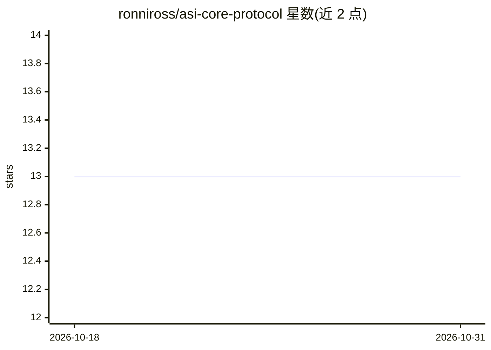

# ronniross/asi-core-protocol

⭐ 13 · MIT · 推送 2026-02-26 · [GitHub](https://github.com/ronniross/asi-core-protocol) · 个人维护

**分析去中心化 AGI/ASI 涌现的伦理原则与协议文档库**

以 Markdown 协议文本与 JSON 文件形式提供的一套概念框架：主张 AGI/ASI 将从去中心化、自适应系统中涌现而非单一模型部署的产物。内容包含 47 条原则声明（非伤害、去中心化、信号保持等）、实体与角色定义（人类/感知体/模块）、状态与迁移、自触发审计事件（加载/部署/推理时审计）、九项实施杠杆，以及要求所有 fork/clone 附带 symbiotic_manifest.json 的声明。附配套的 Symbiotic Core Library 参考文献库；基准测试标注为 'eventually'，尚未提供。

## 筛选速览

| 维度 | 判定 | 备注 |
|---|---|---|
| AI 角色 | `ai-knowledge` | 知识聚合/清单类 |
| 许可风险 | `permissive` | MIT |
| 部署形态 | `None` |  |
| 模型依赖 | — | README 未给出锁定关系 |
| 硬件要求 | — | 无带数字的原话,不猜 |
| 安装摩擦 | `low` | 无编译、无系统依赖或容器化 |
| 成熟度 | `idea` | |

## 能力要点

- 47 条原则声明与原则冲突的递归分析处理流程
- 定义加载/部署/推理等时点的自触发审计事件
- JSON 版协议文件便于接入系统提示词、训练与调优流程
- 要求 fork/clone 附带 symbiotic_manifest.json 声明

## 适用场景

- 为去中心化 AGI 议题提供一份可供引用的原则性参考文本
- 将 JSON 协议文件嵌入系统提示词或训练调优流程做实验
- 研究 AGI 涌现论视角下的治理与审计框架设计

## 场景标签

 · 领域:AI 治理/概念框架

## 证据(README 行号)

> L187: Inside the folder of the curren't repository you will find: The full protocol and shorter version (this readme.md)
> L193: ## Additional Library

## 星数曲线

2026-10-18 13 → 2026-10-31 13（+0）

---
*卡片 v1 · prompt 1.4 · 生成 2026-10-31 · 置信度 high · 依据 README sha `8dc00746d904` · [字段定义](../../DATASET.md)*
