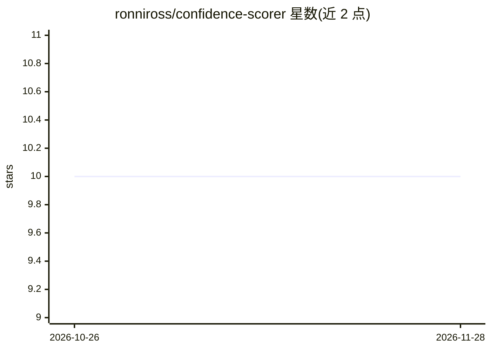

# ronniross/confidence-scorer

⭐ 10 · Python · MIT · 推送 2026-02-26 · [GitHub](https://github.com/ronniross/confidence-scorer) · 个人维护

**为 LLM 输出的可信度提供估计打分的评测方案集**

一组辅助系统脚本与方法论，为 Transformer 语言模型输出估计非幻觉置信度，回应 LLM 生成流利文本却无不确定性信号的问题。定位为叠加在 LLM 集成之上的一个层，向开发者指示对特定回答可给予多少信任。整理了四类置信度估计路径：主模型自我评估、独立克隆/专用第二模型评分、跨模态或外部 API 验证、以及依赖模型内部 attention heads 的信号提取；另附 Qwen 3 模型的示例脚本，采用 MIT 许可并欢迎社区以 fork 方式贡献框架示例。

## 筛选速览

| 维度 | 判定 | 备注 |
|---|---|---|
| AI 角色 | `ai-ecosystem` | LLM/agent 周边工具 |
| 许可风险 | `permissive` | MIT |
| 部署形态 | `None` |  |
| 模型依赖 | — | README 未给出锁定关系 |
| 硬件要求 | — | 无带数字的原话,不猜 |
| 安装摩擦 | `low` | 无编译、无系统依赖或容器化 |
| 成熟度 | — | 结构信号不足 |

## 能力要点

- 四类置信度估计路径：自评估、第二模型、外部验证、内部 attention heads
- 附 Qwen 3 模型的加载与带置信度推理示例脚本
- 通过后续提示要求模型自我评分/复述一致性来估计置信度
- MIT 许可，社区可 fork 贡献特定框架示例

## 适用场景

- 为 LLM 应用输出附加可信度指标
- 研究幻觉检测与不确定性估计方法
- 评估模型对自身回答一致性的自我评估能力

## 场景标签

`模型评测` · 领域:评测与运维

## 证据(README 行号)

> L3: This repository presents a set of auxiliary systems designed to provide a measure of estimated confidence for non-ha
> L7: The goal of this system is to act as a valuable layer on top of an LLM integration, giving developers and users an i

## 星数曲线

2026-10-26 10 → 2026-11-28 10（+0）

---
*卡片 v1 · prompt 1.4 · 生成 2026-11-19 · 置信度 mid · 依据 README sha `53e8666de124` · [字段定义](../../DATASET.md)*
