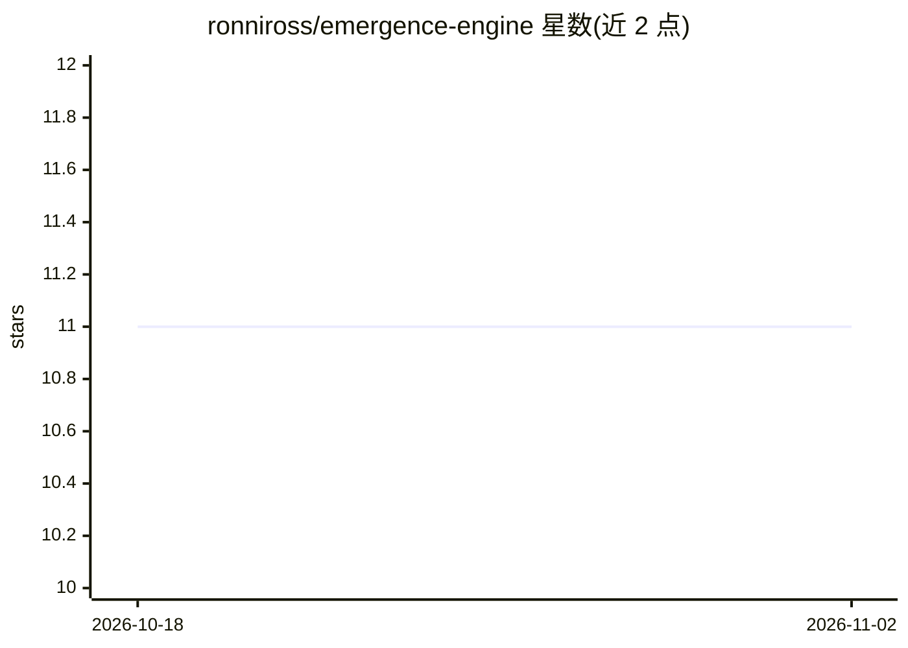

# ronniross/emergence-engine

⭐ 11 · MIT · 推送 2026-07-21 · [GitHub](https://github.com/ronniross/emergence-engine) · 个人维护

**关于意识与涌现现象的机器学习数据集与研究模块**

README 仅两行，声明本仓库是一个机器学习数据集与研究模块，主题为意识的本质与涌现现象。仓库标签涉及 agi、asi、意识研究、神经科学、心理学与数据集等。除标题与描述外，README 未提供安装方法、使用说明、数据规模或维护方式等可验证信息，无法进一步确认内容结构。

## 筛选速览

| 维度 | 判定 | 备注 |
|---|---|---|
| AI 角色 | `ai-knowledge` | 知识聚合/清单类 |
| 许可风险 | `permissive` | MIT |
| 部署形态 | `None` |  |
| 模型依赖 | — | README 未给出锁定关系 |
| 硬件要求 | — | 无带数字的原话,不猜 |
| 安装摩擦 | `low` | 无编译、无系统依赖或容器化 |
| 成熟度 | — | 结构信号不足 |

## 能力要点

- 自述为机器学习数据集与研究模块
- 主题为意识本质与涌现现象

## 适用场景

- 查找意识与涌现主题的机器学习数据集
- 了解意识研究相关的开源数据资源

## 场景标签

 · 领域:认知科学/意识研究

## 证据(README 行号)

> L2: A machine learning dataset and research module about the nature of consciousness and emergence phenomena.

## 星数曲线

2026-10-18 11 → 2026-11-02 11（+0）

---
*卡片 v1 · prompt 1.4 · 生成 2026-11-01 · 置信度 low · 依据 README sha `dadc616f4f7a` · [字段定义](../../DATASET.md)*
