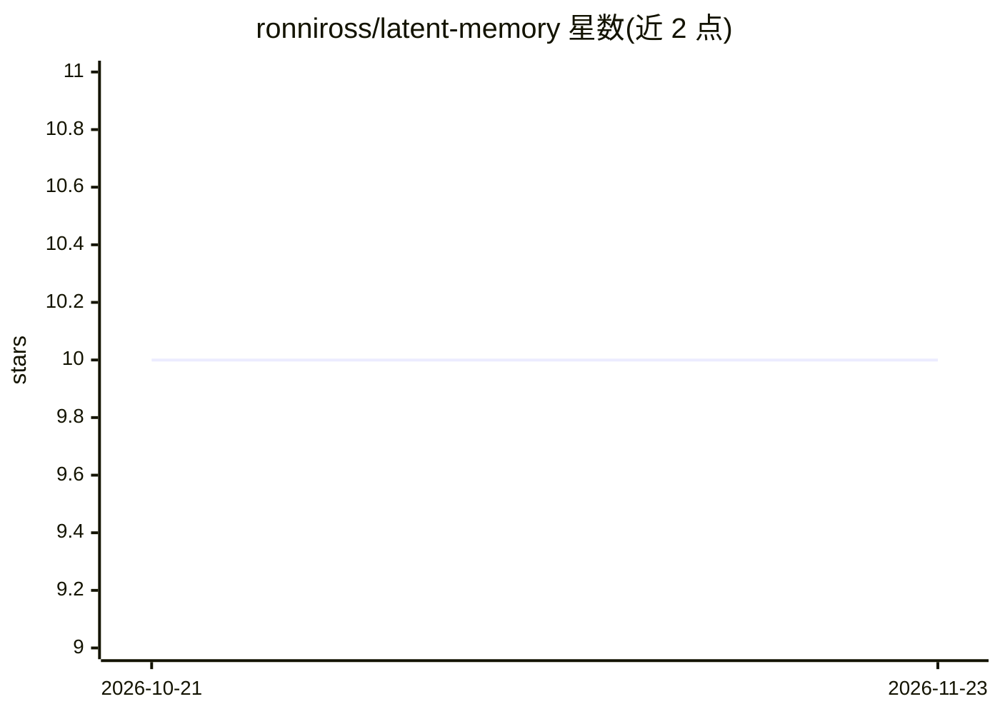

# ronniross/latent-memory

⭐ 10 · Python · MIT · 推送 2026-02-26 · [GitHub](https://github.com/ronniross/latent-memory) · 个人维护

**给 LLM 接入向量语义记忆的模块/工具集**

一个面向大语言模型的上下文感知记忆模块：将对话转换为嵌入向量存入向量数据库（原型使用 FAISS），检索时按语义相似度召回历史对话并格式化为推理上下文。提供四种存储实现（CSV+JSON、NumPy+JSON、HDF5、Pickle），并对比了基于正则关键词匹配的传统记忆方案。MIT 许可。README 明确说明将检索内容完全整合进推理过程仍待探索；另含要求 fork 遵循原则声明的 Symbiotic Manifest 条款。

## 筛选速览

| 维度 | 判定 | 备注 |
|---|---|---|
| AI 角色 | `ai-ecosystem` | LLM/agent 周边工具 |
| 许可风险 | `permissive` | MIT |
| 部署形态 | `None` |  |
| 模型依赖 | — | README 未给出锁定关系 |
| 硬件要求 | — | 无带数字的原话,不猜 |
| 安装摩擦 | `low` | 无编译、无系统依赖或容器化 |
| 成熟度 | — | 结构信号不足 |

## 能力要点

- 对话转嵌入向量并存入 FAISS 向量数据库，按语义相似度检索
- 提供 CSV+JSON、NumPy+JSON、HDF5、Pickle 四种存储实现
- 检索结果格式化为 LLM 输入上下文
- 对话元数据（ID、摘要、时间戳）随向量一并保存

## 适用场景

- 为多轮对话应用添加跨会话语义记忆
- 替代基于关键词匹配的简单记忆方案
- 研究检索记忆与推理过程的整合方式

## 场景标签

`Agent 记忆` `向量数据库` · 领域:Agent 开发

## 证据(README 行号)

> L5: Latent Memory is a Module for Large Language Models that seek to integrate a vector-based memory system into the LLM
> L58: 2. **Store in a Vector Database**: The embeddings are loaded from their respective storage format and saved into a 

## 星数曲线

2026-10-21 10 → 2026-11-23 10（+0）

---
*卡片 v1 · prompt 1.4 · 生成 2026-11-19 · 置信度 mid · 依据 README sha `e67236624d4a` · [字段定义](../../DATASET.md)*
