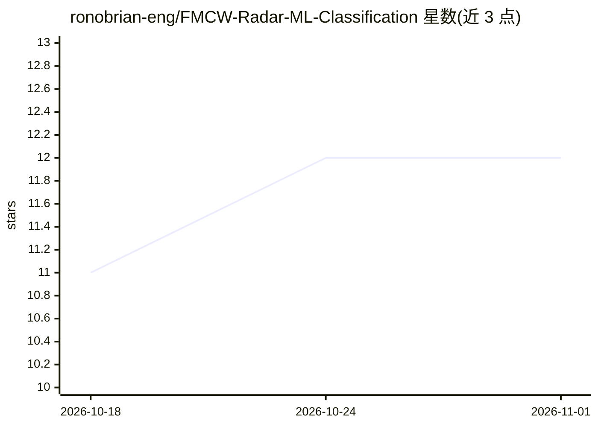

# ronobrian-eng/FMCW-Radar-ML-Classification

⭐ 12 · MATLAB · MIT · 推送 2025-11-14 · [GitHub](https://github.com/ronobrian-eng/FMCW-Radar-ML-Classification) · 个人维护

**MATLAB FMCW 雷达仿真 + SVM 分类 Human/Car/Drone 的教学作品**

纯软件的 MATLAB FMCW 雷达仿真项目：生成 77 GHz、150 MHz 扫频的线性调频信号，经 Range FFT 与 Doppler FFT 得到 Range–Doppler 图及指定距离单元的 micro-Doppler 频谱图。基于合成速度轮廓构造 Human/Car/Drone 三类目标，提取均值、标准差、最大绝对速度等特征，用多类 SVM（fitcecoc）训练并输出分类准确率。无需外部硬件，运行单个脚本即可复现，定位为 RF+ML 教学/作品集项目。

## 筛选速览

| 维度 | 判定 | 备注 |
|---|---|---|
| AI 角色 | `ai-native` | 本体是模型或模型工具 |
| 许可风险 | `permissive` | MIT |
| 部署形态 | `None` |  |
| 模型依赖 | — | README 未给出锁定关系 |
| 硬件要求 | — | 无带数字的原话,不猜 |
| 安装摩擦 | `low` | 无编译、无系统依赖或容器化 |
| 成熟度 | — | 结构信号不足 |

## 能力要点

- 77 GHz 线性 FMCW 信号链仿真（Range/Doppler FFT、Range–Doppler 图）
- micro-Doppler 风格频谱图与特征空间可视化
- 速度统计特征 + 多类 SVM（fitcecoc）三分类
- 纯软件仿真，无外部硬件要求

## 适用场景

- 雷达信号处理教学与演示
- 求职作品集展示 RF+ML 能力
- 作为接入真实硬件或更高级 ML 模型的基线项目

## 场景标签

 · 领域:雷达/信号处理/汽车感知

## 证据(README 行号)

> L4: This project implements a **software-only FMCW radar simulator** in **MATLAB** and combines it with a simple **machi
> L30: - Multi-class SVM classifier (`fitcecoc`) trained and evaluated

## 星数曲线

2026-10-18 11 → 2026-11-01 12（+1）

---
*卡片 v1 · prompt 1.4 · 生成 2026-11-01 · 置信度 high · 依据 README sha `65210e40903d` · [字段定义](../../DATASET.md)*
