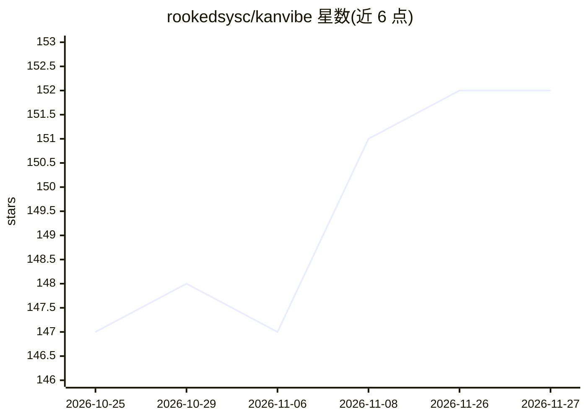

# rookedsysc/kanvibe

⭐ 152 · TypeScript · AGPL-3.0 · 推送 2026-11-26 · [GitHub](https://github.com/rookedsysc/kanvibe) · [官网](https://kanvibe.rookedsysc.com) · 个人维护 · 中文 README

**面向 AI 编程 agent 的键盘优先桌面看板工作区**

macOS 桌面看板应用，将 Claude Code、Codex、Gemini CLI、OpenCode 等 AI 编程 agent 的任务放进独立工作区，每个任务聚合分支、git worktree 与内嵌终端；agent hook 驱动看板状态流转，桌面与手机经本地网络或 Tailscale 配对后可查看同一终端并下发指令。移动端为早期预览（韩文界面）。桌面端经 Homebrew tap 安装，移动端需从源码构建 Flutter 应用。

## 筛选速览

| 维度 | 判定 | 备注 |
|---|---|---|
| AI 角色 | `ai-ecosystem` | LLM/agent 周边工具 |
| 许可风险 | `viral` | AGPL-3.0 |
| 部署形态 | `library` | 以包/库形式分发 |
| 模型依赖 | — | README 未给出锁定关系 |
| 硬件要求 | — | 无带数字的原话,不猜 |
| 安装摩擦 | `low` | 无编译、无系统依赖或容器化 |
| 成熟度 | `idea` | |

## 能力要点

- 任务工作区聚合分支、git worktree 与内嵌终端
- agent hook 驱动看板状态（progress/waiting/review）
- 手机/平板配对后远程查看终端并发送指令
- 支持 tmux/zellij/Herdr 会话与 Claude/Codex 聊天记录匹配

## 适用场景

- 在同一看板上跟踪多个 AI agent 的编码任务进度
- 下班后用手机查看 agent 输出并追加指令
- 按 worktree 隔离管理多个并行开发分支

## 场景标签

`编码 Agent` · 领域:编码与开发

## 证据(README 行号)

> L7: KanVibe is a keyboard-first macOS Kanban workspace for AI coding agents. Run Claude Code, Codex, Gemini CLI, and Ope
> L66: 1. **See what needs attention.** Agent hooks update the board as work moves through progress, waiting, and review.

## 星数曲线

2026-10-25 147 → 2026-11-27 152（+5）

---
*卡片 v1 · prompt 1.4 · 生成 2026-11-27 · 置信度 low · 依据 README sha `77b998117407` · [字段定义](../../DATASET.md)*
