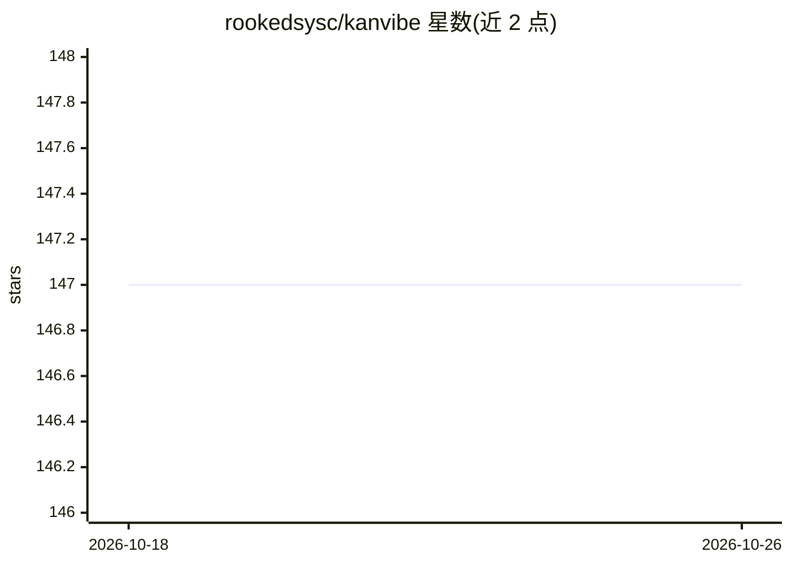

# rookedsysc/kanvibe

⭐ 147 · TypeScript · AGPL-3.0 · 推送 2026-10-25 · [GitHub](https://github.com/rookedsysc/kanvibe) · 个人维护 · 中文 README

**键盘优先的桌面看板工作台：集中管理 AI 编码 agent 任务与终端会话**

面向使用 AI 编码 CLI 的开发者的 Kanban 看板工作台：为每个分支任务自动创建 git worktree 与 tmux/zellij 会话，通过 Claude Code、Gemini CLI、Codex CLI、OpenCode 的 hooks 自动流转任务状态（TODO→DONE 时自动清理分支与会话）。浏览器与桌面端经 WebSocket 实时同步，支持 SSH 远程终端、多面板布局、Vim 风格键盘操作，并读取各 CLI 本地凭据展示 Claude/Codex/Gemini 剩余配额。运行需 git、tmux、gh，经 Homebrew Cask 安装。

## 筛选速览

| 维度 | 判定 | 备注 |
|---|---|---|
| AI 角色 | `ai-ecosystem` | LLM/agent 周边工具 |
| 许可风险 | `viral` | AGPL-3.0 |
| 部署形态 | `None` |  |
| 模型依赖 | locked-api |  |
| 硬件要求 | — | 无带数字的原话,不猜 |
| 安装摩擦 | `low` | 无编译、无系统依赖或容器化 |
| 成熟度 | — | 结构信号不足 |

## 能力要点

- 分支任务自动创建 git worktree 与 tmux/zellij 终端会话
- AI agent hooks 驱动任务在 5 个状态间自动流转，DONE 时自动清理
- 读取 Claude/Codex/Gemini 各账户剩余配额，复用 CLI 本地登录凭据
- 看板卡片实时显示各任务的运行中 agent 会话与子任务

## 适用场景

- 在统一看板中管理多个项目的 AI 编码 agent 任务
- 为每个分支任务准备隔离的 worktree 和终端工作区
- 不离开终端即可查看各 AI 账户剩余配额

## 场景标签

 · 领域:开发者工具/AI agent 工作流

## 证据(README 行号)

> L5: KanVibe keeps AI coding work out of scattered terminal tabs. Track branch-based tasks on a real-time Kanban board, o
> L91: ## Prerequisites

## 星数曲线

2026-10-18 147 → 2026-10-26 147（+0）

---
*卡片 v1 · prompt 1.4 · 生成 2026-10-22 · 置信度 high · 依据 README sha `bbf4f1c644ab` · [字段定义](../../DATASET.md)*
