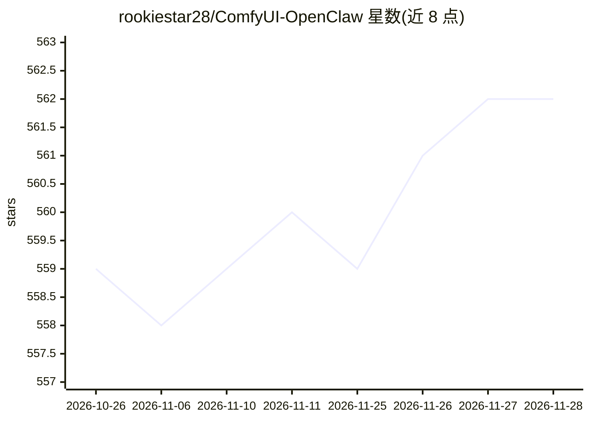

# rookiestar28/ComfyUI-OpenClaw

⭐ 562 · Python · MIT · 推送 2026-11-25 · [GitHub](https://github.com/rookiestar28/ComfyUI-OpenClaw) · 个人维护

**为 ComfyUI 提供安全自动化编排层的自定义节点包**

面向 ComfyUI 的编排层扩展：以自定义节点包形式提供 LLM 辅助节点（planner/refiner/vision/batch）、内置 OpenClaw 面板、独立远程管理控制台、安全默认的 HTTP API（webhook、触发器、定时任务、审批、预设），并接入 Discord、Telegram、WhatsApp、LINE、微信、KakaoTalk、Slack、飞书 8 个消息平台。强调安全默认：信任边界、SSRF 校验、多租户隔离、审计脱敏与 CI 验证流程。经 ComfyUI-Manager 或 git clone 安装。

## 筛选速览

| 维度 | 判定 | 备注 |
|---|---|---|
| AI 角色 | `ai-ecosystem` | LLM/agent 周边工具 |
| 许可风险 | `permissive` | MIT |
| 部署形态 | `desktop` | 安装包/桌面程序 |
| 模型依赖 | local-ok | 支持本地模型 |
| 硬件要求 | — | 无带数字的原话,不猜 |
| 安装摩擦 | `medium` | 含编译或系统依赖之一 |
| 成熟度 | — | 结构信号不足 |

## 能力要点

- LLM 辅助节点（planner/refiner/vision/batch 变体）
- 8 个消息平台接入与定时任务结果回传
- 安全默认架构：信任边界、SSRF 校验、多租户隔离
- webhook/触发器/定时/审批/preset 的自动化 API

## 适用场景

- 通过消息平台远程触发和接收 ComfyUI 生图任务
- 为团队部署带审批与多租户隔离的 ComfyUI 自动化
- 用 LLM 辅助节点批量处理图像工作流

## 场景标签

`工作流自动化` `图像生成` · 领域:效率与自动化

## 证据(README 行号)

> L5: ComfyUI-OpenClaw is a **security-first orchestration layer** for ComfyUI that combines hardened automation APIs, emb
> L7: - **LLM-assisted nodes** (planner/refiner/vision/batch variants)
> L10: - **A secure-by-default HTTP API** for automation (webhooks, triggers, schedules, approvals, presets, rewrite recip

## 星数曲线

2026-10-26 559 → 2026-11-28 562（+3）

---
*卡片 v1 · prompt 1.4 · 生成 2026-11-26 · 置信度 high · 依据 README sha `daaad6e6802d` · [字段定义](../../DATASET.md)*
