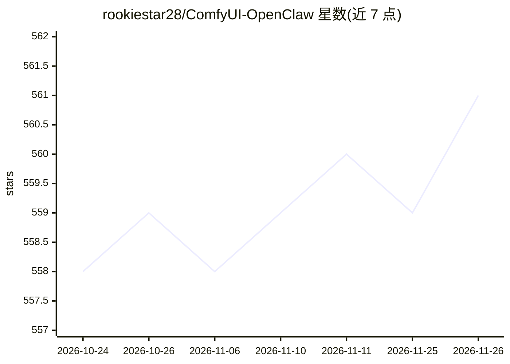

# rookiestar28/ComfyUI-OpenClaw

⭐ 561 · Python · MIT · 推送 2026-11-25 · [GitHub](https://github.com/rookiestar28/ComfyUI-OpenClaw) · 个人维护 · 中文 README

**ComfyUI 的安全优先编排层：自动化 API 与多平台机器人接入**

作为 ComfyUI 自定义节点包与内嵌运维平台，提供 LLM 辅助节点（planner/refiner/vision/batch）、管理面板、远程管理控制台、webhook/定时/审批等自动化 HTTP API，并接入 Discord、Telegram、WhatsApp、LINE、微信、KakaoTalk、Slack、飞书/Lark 八个消息平台。安全设计为核心卖点：fail-closed 部署、信任边界划分、密钥服务端存储、SSRF 校验、多租户隔离等。通过 ComfyUI-Manager 或 git clone 安装。

## 筛选速览

| 维度 | 判定 | 备注 |
|---|---|---|
| AI 角色 | `ai-ecosystem` | LLM/agent 周边工具 |
| 许可风险 | `permissive` | MIT |
| 部署形态 | `desktop` | 安装包/桌面程序 |
| 模型依赖 | — | README 未给出锁定关系 |
| 硬件要求 | — | 无带数字的原话,不猜 |
| 安装摩擦 | `medium` | 含编译或系统依赖之一 |
| 成熟度 | — | 结构信号不足 |

## 能力要点

- 8 个消息平台连接器（Discord/Telegram/WhatsApp/LINE/微信/KakaoTalk/Slack/飞书）
- LLM 辅助节点与自动化 API（webhook、触发器、定时任务、审批、预设）
- fail-closed 安全模型：信任边界、密钥服务端加密存储、SSRF 校验、多租户隔离
- 内置运维 UI 与独立远程管理控制台（/openclaw/admin）

## 适用场景

- 把 ComfyUI 图像生成流程接入群机器人并支持定时投递结果
- 需要审批门控与 Webhook 触发的生产级 AIGC 自动化部署
- 通过浏览器在移动端远程管理 ComfyUI 运行任务

## 场景标签

`图像生成` `工作流自动化` · 领域:效率与自动化

## 证据(README 行号)

> L5: ComfyUI-OpenClaw is a **security-first orchestration layer** for ComfyUI that combines hardened automation APIs, emb
> L18: - **Primary artifact**: ComfyUI custom node pack

## 星数曲线

2026-10-24 558 → 2026-11-26 561（+3）

---
*卡片 v1 · prompt 1.4 · 生成 2026-11-25 · 置信度 mid · 依据 README sha `7d9a9f129fd7` · [字段定义](../../DATASET.md)*
