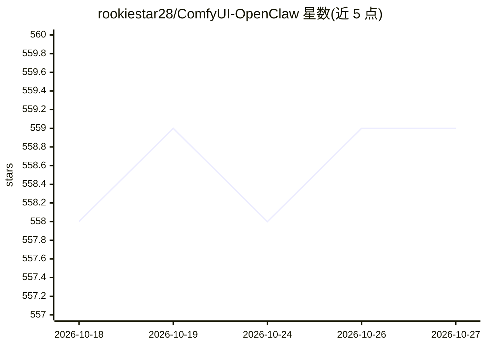

# rookiestar28/ComfyUI-OpenClaw

⭐ 559 · Python · MIT · 推送 2026-10-26 · [GitHub](https://github.com/rookiestar28/ComfyUI-OpenClaw) · 个人维护 · 中文 README

**ComfyUI 的安全优先编排层：加固自动化 API 与远程管理控制台**

以 ComfyUI 自定义节点包为主要交付物的编排层：提供 LLM 辅助节点（planner/refiner/vision/批处理变体）、内置扩展面板、独立远程管理控制台（/openclaw/admin）、带 webhook/触发器/定时/审批/预设的 HTTP API，并支持 Discord、Telegram、WhatsApp、LINE、微信、KakaoTalk、Slack、飞书/Lark 共 8 个消息平台接入。采用控制面分离与 fail-closed 安全默认，含 SSRF 校验、多租户隔离与 CI 对抗性验证门。通过 ComfyUI-Manager 或 git clone 安装，Python 3.13 为已验证基线。

## 筛选速览

| 维度 | 判定 | 备注 |
|---|---|---|
| AI 角色 | `ai-ecosystem` | LLM/agent 周边工具 |
| 许可风险 | `permissive` | MIT |
| 部署形态 | `desktop` | 安装包/桌面程序 |
| 模型依赖 | — | README 未给出锁定关系 |
| 硬件要求 | — | 无带数字的原话,不猜 |
| 安装摩擦 | `medium` | 含编译或系统依赖之一 |
| 成熟度 | — | 结构信号不足 |

## 能力要点

- LLM 辅助节点（planner/refiner/vision/batch 变体）
- 支持 8 个消息平台的 connector（Discord/Telegram/WhatsApp/LINE/微信/KakaoTalk/Slack/飞书）
- 安全默认的 HTTP 自动化 API：webhook、触发器、定时、审批、预设
- 控制面分离架构与独立远程管理控制台（/openclaw/admin）

## 适用场景

- 把 ComfyUI 变成可靠的自动化目标并设定管理边界
- 通过手机或远程浏览器操作 ComfyUI 运行与审批
- 从聊天平台触发并接收生成任务结果

## 场景标签

`图像生成` `工作流自动化` · 领域:效率与自动化

## 证据(README 行号)

> L5: ComfyUI-OpenClaw is a **security-first orchestration layer** for ComfyUI that combines hardened automation APIs, emb
> L18: - **Primary artifact**: ComfyUI custom node pack

## 星数曲线

2026-10-18 558 → 2026-10-27 559（+1）

---
*卡片 v1 · prompt 1.4 · 生成 2026-10-21 · 置信度 high · 依据 README sha `e4d86eab1253` · [字段定义](../../DATASET.md)*
