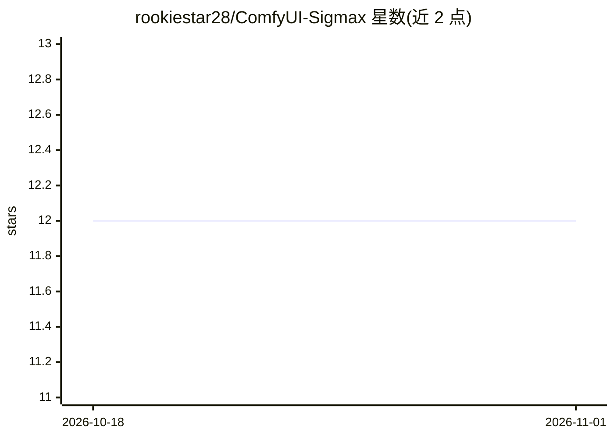

# rookiestar28/ComfyUI-Sigmax

⭐ 12 · Python · MIT · 推送 2026-10-27 · [GitHub](https://github.com/rookiestar28/ComfyUI-Sigmax) · 个人维护

**ComfyUI 自定义节点：为多模型构建模型感知的 sigma 调度表**

面向 ComfyUI 用户的自定义节点包，提供 25 个命名空间节点，为 Krea 2、Z-Image、FLUX.1-schnell、Qwen Image 2.1、SD3、MiniMax H3、Wan 2.1/2.2、LTX 等图像与视频模型构建模型感知的 SIGMAS 调度表，并支持调度表的切片、拼接、重采样、比较与检查点头部检查（不加载权重）。仅构建外部 sigma，不替代采样器、不下载模型、除 ComfyUI 自带库外无强制第三方运行时依赖。要求 Python 3.10+ 与 ComfyUI 0.29.0+，可经 ComfyUI Manager 或 git clone 安装。

## 筛选速览

| 维度 | 判定 | 备注 |
|---|---|---|
| AI 角色 | `ai-ecosystem` | LLM/agent 周边工具 |
| 许可风险 | `permissive` | MIT |
| 部署形态 | `None` |  |
| 模型依赖 | — | README 未给出锁定关系 |
| 硬件要求 | — | 无带数字的原话,不猜 |
| 安装摩擦 | `low` | 无编译、无系统依赖或容器化 |
| 成熟度 | `idea` | |

## 能力要点

- 25 个命名空间节点覆盖调度构建、模型感知选择、检查与编辑
- 支持 Krea 2、Z-Image、Qwen Image 2.1、MiniMax H3、Wan 2.1/2.2、LTX 等图像/视频模型族
- 不加载权重即可检查 checkpoint 头部，输出带版本与指纹的调度信息以支持可复现工作流
- 除 ComfyUI 自带库外无强制第三方运行时依赖

## 适用场景

- 在 ComfyUI 中为特定图像/视频模型获取匹配的 sigma 调度表
- 对比与检查不同调度表以保证工作流可复现
- 按模型族显式选择调度而非通用回退

## 场景标签

`图像生成` `视频生成` · 领域:内容生成

## 证据(README 行号)

> L3: ComfyUI-Sigmax provides model-aware sigma schedules for ComfyUI, with supported Krea 2, Z-Image, FLUX.1-schnell, Qwe
> L43: - Twenty-five namespaced nodes for schedule construction, model-aware selection, inspection, comparison, editing, c
> L54: Sigmax builds `SIGMAS` for ComfyUI custom sampling. It does not replace the sampler and does not download models.

## 星数曲线

2026-10-18 12 → 2026-11-01 12（+0）

---
*卡片 v1 · prompt 1.4 · 生成 2026-11-01 · 置信度 high · 依据 README sha `5c2d66005c0f` · [字段定义](../../DATASET.md)*
