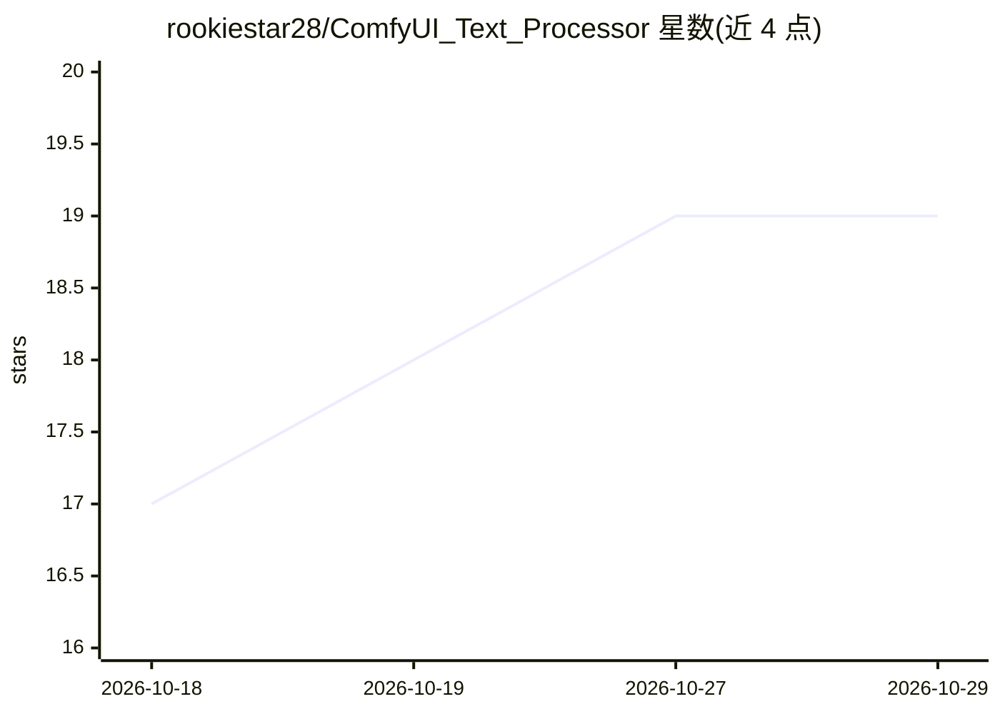

# rookiestar28/ComfyUI_Text_Processor

⭐ 19 · Python · MIT · 推送 2026-10-28 · [GitHub](https://github.com/rookiestar28/ComfyUI_Text_Processor) · 个人维护

**ComfyUI 文本处理节点包：20 个节点用于提示词与工作流自动化**

面向 ComfyUI 的自定义节点集合，提供 20 个生产节点，覆盖文本过滤（17 种操作模式，含正则、LLM 输出的 JSON/代码块/Markdown 解析）、文本合并与拆分、动态 Wildcards、文本存储、全局随机种子、图像缩放/拼接/批处理加载、文字渲染到图像与带隐私控制的图像保存等。文本过滤节点采用双输出设计支持节点链式处理，LLM 解析采用首个有效 JSON 的有界提取。要求 Python 3.10+ 与 ComfyUI Core 0.22.3+，标准节点无需额外第三方运行时包。

## 筛选速览

| 维度 | 判定 | 备注 |
|---|---|---|
| AI 角色 | `ai-ecosystem` | LLM/agent 周边工具 |
| 许可风险 | `permissive` | MIT |
| 部署形态 | `library` | 以包/库形式分发 |
| 模型依赖 | — | README 未给出锁定关系 |
| 硬件要求 | — | 无带数字的原话,不猜 |
| 安装摩擦 | `low` | 无编译、无系统依赖或容器化 |
| 成熟度 | — | 结构信号不足 |

## 能力要点

- Advanced Text Filter 提供 17 种操作模式，含 LLM 输出解析（JSON/代码块/Markdown 清理）
- 双输出设计（processed/remaining）支持节点链式多步文本处理
- 全局随机种子、分辨率选择器与图像批处理等 20 个生产节点
- Simple Expression 使用有界内置解释器执行白名单运算，不做动态 Python 执行

## 适用场景

- 在 ComfyUI 工作流中清洗和解析 LLM 生成的提示词或结构化输出
- 构建动态提示词与批量替换规则的工作流
- 配合随机种子与分辨率选择节点组织可复现的生成工作流

## 场景标签

`提示工程` `工作流自动化` · 领域:Agent 开发

## 证据(README 行号)

> L3: An advanced automation toolkit with 20 production nodes for text processing, reusable storage, dynamic prompts, seed
> L60: - Version 1.8.2 supports Python 3.10+ and ComfyUI Core 0.22.3+, with contracts
> L116: * **Release requirements:** ComfyUI Text Processor 1.8.2 requires Python 3.10+ and ComfyUI Core 0.22.3+.

## 星数曲线

2026-10-18 17 → 2026-10-29 19（+2）

---
*卡片 v1 · prompt 1.4 · 生成 2026-10-28 · 置信度 mid · 依据 README sha `98d76e82d534` · [字段定义](../../DATASET.md)*
