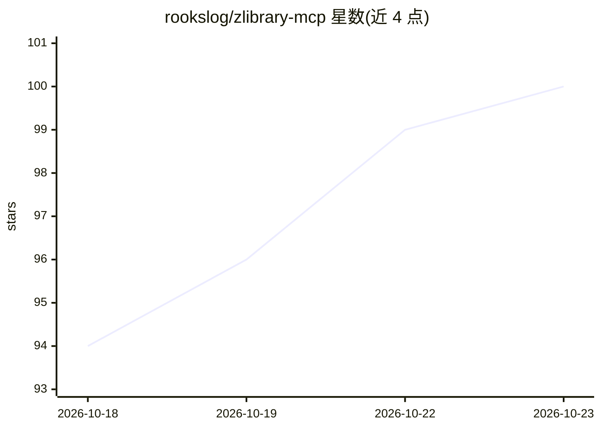

# rookslog/zlibrary-mcp

⭐ 100 · Python · MIT · 推送 2026-10-22 · [GitHub](https://github.com/rookslog/zlibrary-mcp) · [官网](https://www.npmjs.com/package/zlibrary-mcp) · 个人维护

**供 AI 助手检索与下载图书的 MCP 服务器**

面向 MCP 客户端（Claude Code/Desktop、Cline、RooCode）的图书获取服务器，提供 search/get_book/download/get_limits/get_history 五个工具，覆盖 Library Genesis、Z-Library 与 Anna's Archive 三个来源。下载落到服务器磁盘并生成带 SHA-256 与溯源信息的 JSON sidecar；文件内容不进入工具响应。LibGen 无需凭据，Z-Library 需账号，Anna's 下载需会员 key。2.0 为破坏性接口变更，文本处理功能已移出。通过 npm 全局安装（需 Node 22+、Python 3.10+、uv），另提供 Docker HTTP 部署。

## 筛选速览

| 维度 | 判定 | 备注 |
|---|---|---|
| AI 角色 | `ai-ecosystem` | LLM/agent 周边工具 |
| 许可风险 | `permissive` | MIT |
| 部署形态 | `self-host` | docker 或自建部署 |
| 模型依赖 | — | README 未给出锁定关系 |
| 硬件要求 | — | 无带数字的原话,不猜 |
| 安装摩擦 | `low` | 无编译、无系统依赖或容器化 |
| 成熟度 | — | 结构信号不足 |

## 能力要点

- 五工具接口：元数据搜索、版本详情、下载、限额查询、账户历史
- 三个来源：LibGen（免凭据）、Z-Library（账号）、Anna's Archive（下载需 key）
- 下载带意图回执、SHA-256 校验、去重跳过与配额保护，凭据不落盘
- Docker 部署经 SuperGateway 以 SSE 提供 HTTP transport

## 适用场景

- 让 Claude Code 或 Cline 等客户端搜索并下载图书到服务器磁盘
- 为 RAG 流水线获取图书原文文件与带溯源的元数据记录
- 免账号从 LibGen 检索下载，按需切换多来源

## 场景标签

`网页抓取` · 领域:效率与自动化

## 证据(README 行号)

> L7: An acquisition server for books and articles: find an edition, inspect its metadata,
> L8: and download the original file. Five MCP tools serve Library Genesis, Z-Library and

## 星数曲线

2026-10-18 94 → 2026-10-23 100（+6）

---
*卡片 v1 · prompt 1.4 · 生成 2026-10-23 · 置信度 high · 依据 README sha `e8e37e2d4240` · [字段定义](../../DATASET.md)*
