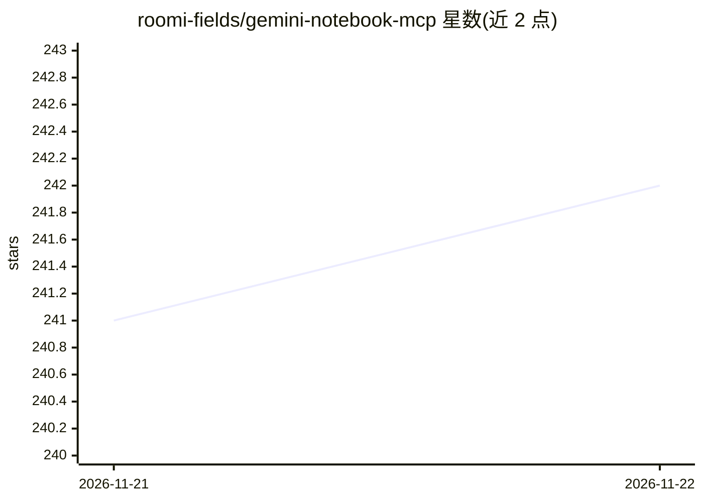

# roomi-fields/gemini-notebook-mcp

⭐ 242 · TypeScript · MIT · 推送 2026-11-20 · [GitHub](https://github.com/roomi-fields/gemini-notebook-mcp) · [官网](https://notebooklm.roomi-fields.com/) · 个人维护

**让 Agent 与自动化平台以 REST/MCP 调用 NotebookLM 的服务器**

非官方的 NotebookLM（现更名 Gemini Notebook）接入层：提供 62 端点的本地 HTTP REST API、MCP 服务器与 UTCP 接口，附带 Rust/Ruby 客户端，供 Claude Code、Cursor、Codex、n8n、Zapier、Make 等调用。功能覆盖带引用的问答、源管理、聊天历史读取、多笔记库管理，以及音频/视频/信息图/报告/演示等 Studio 内容的程序化生成与下载。支持多账号轮换与自动重认证。项目通过未公开的 batchexecute RPC 接口工作，以 Playwright 浏览器为自动回退，接口可能随 Google 变更而失效。

## 筛选速览

| 维度 | 判定 | 备注 |
|---|---|---|
| AI 角色 | `ai-ecosystem` | LLM/agent 周边工具 |
| 许可风险 | `permissive` | MIT |
| 部署形态 | `self-host` | docker 或自建部署 |
| 模型依赖 | — | README 未给出锁定关系 |
| 硬件要求 | — | 无带数字的原话,不猜 |
| 安装摩擦 | `low` | 无编译、无系统依赖或容器化 |
| 成熟度 | — | 结构信号不足 |

## 能力要点

- 62 端点 HTTP REST API + MCP 服务器 + UTCP 三种调用方式
- 带引用问答：返回来源名称与引用原文摘录
- Studio 全量生成：音频、视频、信息图、报告、演示、数据表、闪卡、测验、思维导图
- 多账号轮换自动重认证，支持批量 1000+ 问题通宵运行

## 适用场景

- 把 NotebookLM 作为 n8n/Zapier 工作流中的一个节点处理文档问答
- 批量跑博士文献综述问题并轮换账号应对每日配额
- 让 Claude Code 等 Agent 直接查询与操作自己的笔记库
- 对同一批源一键生成播客、视频、幻灯片等多种产物

## 场景标签

`文档问答` `科研工具` `工作流自动化` `编码 Agent` · 领域:效率与自动化

## 证据(README 行号)

> L1: # NotebookLM REST API + MCP server
> L3: **Automate Google Gemini Notebook — formerly, and still widely known as, NotebookLM — at scale. 62-endpoint HTTP RES
> L26: 🔗 **No-code automation pipelines** — The 62-endpoint REST API means NotebookLM becomes a step in n8n, Zapier, Make,

## 星数曲线

2026-11-21 241 → 2026-11-22 242（+1）

---
*卡片 v1 · prompt 1.4 · 生成 2026-11-21 · 置信度 high · 依据 README sha `025be93a4134` · [字段定义](../../DATASET.md)*
