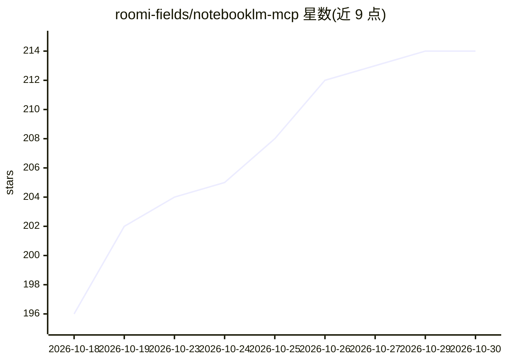

# roomi-fields/notebooklm-mcp

⭐ 214 · TypeScript · MIT · 推送 2026-10-24 · [GitHub](https://github.com/roomi-fields/notebooklm-mcp) · [官网](https://roomi-fields.github.io/notebooklm-mcp/) · 个人维护

**把 Google NotebookLM 封装为 45 端点 REST API 与 MCP 服务器**

非官方项目，通过 NotebookLM 内部 batchexecute RPC 接口（Playwright 浏览器作为回退通道）提供 45 端点 HTTP REST API 与 MCP 服务器：带引用的问答（含引用原文摘录、5 种引用格式）、音频/视频/信息图/报告/演示文稿/数据表等 Studio 内容生成与下载、笔记本与来源管理、个人及 Google Workspace 多账号轮换与自动重认证。面向 Claude Code / Cursor / Codex 等 MCP 客户端与 n8n / Zapier / Make 等自动化平台。限制：依赖未公开文档的内部接口，可能随 Google 变更失效；远程访问与 Docker 需设置 API key；Node ≥ 22。

## 筛选速览

| 维度 | 判定 | 备注 |
|---|---|---|
| AI 角色 | `ai-ecosystem` | LLM/agent 周边工具 |
| 许可风险 | `permissive` | MIT |
| 部署形态 | `self-host` | docker 或自建部署 |
| 模型依赖 | — | README 未给出锁定关系 |
| 硬件要求 | — | 无带数字的原话,不猜 |
| 安装摩擦 | `low` | 无编译、无系统依赖或容器化 |
| 成熟度 | — | 结构信号不足 |

## 能力要点

- 45 端点 HTTP REST API + MCP 双通道
- 答案附带引用及原文摘录，5 种引用格式
- 9 类 Studio 内容生成（音频/视频/报告等）与下载
- 多账号轮换、自动重认证与批量断点续跑（vault_batch）

## 适用场景

- 让 Claude Code / Cursor / Codex 通过 MCP 调用 NotebookLM 做引用式问答
- 在 n8n / Zapier / Make 中把 NotebookLM 作为工作流步骤
- 跨多个笔记本批量跑 1000+ 研究问题并缓存答案离线复用

## 场景标签

`知识库管理` `文档问答` · 领域:知识与检索

## 证据(README 行号)

> L3: **Automate Google NotebookLM at scale. 45-endpoint HTTP REST API for n8n / Zapier / Make / curl, plus an MCP server 
> L28: 🤖 **Agent tooling** — The same engine over MCP for Claude Code, Cursor and Codex, with a bundled skill that primes 
> L135: - **MCP Protocol** — Claude Code, Cursor, Codex, any MCP client

## 星数曲线

2026-10-18 196 → 2026-10-30 214（+18）

---
*卡片 v1 · prompt 1.4 · 生成 2026-10-22 · 置信度 high · 依据 README sha `2a81e36f21bb` · [字段定义](../../DATASET.md)*
