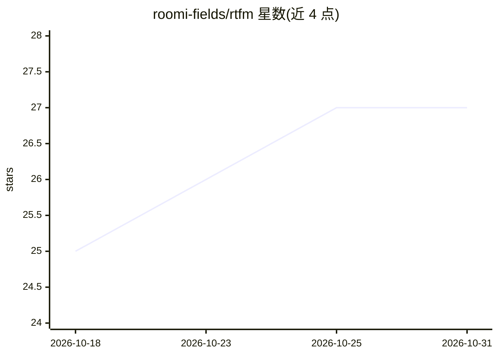

# roomi-fields/rtfm

⭐ 27 · Python · MIT · 推送 2026-10-30 · [GitHub](https://github.com/roomi-fields/rtfm) · [官网](https://rtfm.roomi-fields.com/) · 个人维护

**给 AI 编程 agent 的本地检索层：索引代码/文档/法律/研究资料并经 MCP 提供上下文**

面向 AI coding agent 的开源检索层：一条命令建立 SQLite 索引，将代码、文档、PDF、LaTeX、法律文本等 24 类格式解析入库，通过 MCP 提供 FTS5 全文、语义与混合检索及渐进式披露（先返回约 300 token 元数据再按需展开），并含文件级知识图谱与无限版本历史。以 Claude Code 插件或 pip 包安装，本地运行、无需 API key。附 Obsidian vault 模式、NotebookLM 集成与作者自测基准；作者自述在小仓库（<1k 文件）上 grep 足够、RTFM 反增开销。

## 筛选速览

| 维度 | 判定 | 备注 |
|---|---|---|
| AI 角色 | `ai-ecosystem` | LLM/agent 周边工具 |
| 许可风险 | `permissive` | MIT |
| 部署形态 | `library` | 以包/库形式分发 |
| 模型依赖 | — | README 未给出锁定关系 |
| 硬件要求 | — | 无带数字的原话,不猜 |
| 安装摩擦 | `medium` | 含编译或系统依赖之一 |
| 成熟度 | — | 结构信号不足 |

## 能力要点

- 24 类解析器（含 EPUB/DOCX/ODT/MIDI/音频），单一 SQLite 库
- MCP 提供 FTS5/语义/混合检索与渐进式披露
- 文件级知识图谱与无限版本历史，跨项目记忆索引
- Obsidian vault 模式：解析 wikilinks 为图边并生成导航文件

## 适用场景

- 让 Claude Code 等编程 agent 在大型多领域项目中快速定位代码、法条或论文段落
- 法律/金融/医疗团队把法规、XBRL、临床指南与代码统一检索
- 为 Obsidian 研究库生成可扩展的索引、图谱与孤儿笔记报告

## 场景标签

`知识图谱` `语义搜索` `文档解析` · 领域:知识与检索

## 证据(README 行号)

> L7: Index everything in your project — code, docs, PDFs, legal texts, research, data — and your agent finds the right co
> L31: **RTFM indexes everything.** One command, one SQLite file, one retrieval layer your agent queries before grepping.
> L103: Then point your MCP client at `rtfm-serve` (the entry exposed by the pip package). Optional extras via `pip instal

## 星数曲线

2026-10-18 25 → 2026-10-31 27（+2）

---
*卡片 v1 · prompt 1.4 · 生成 2026-10-26 · 置信度 high · 依据 README sha `cfc58a5d9d07` · [字段定义](../../DATASET.md)*
