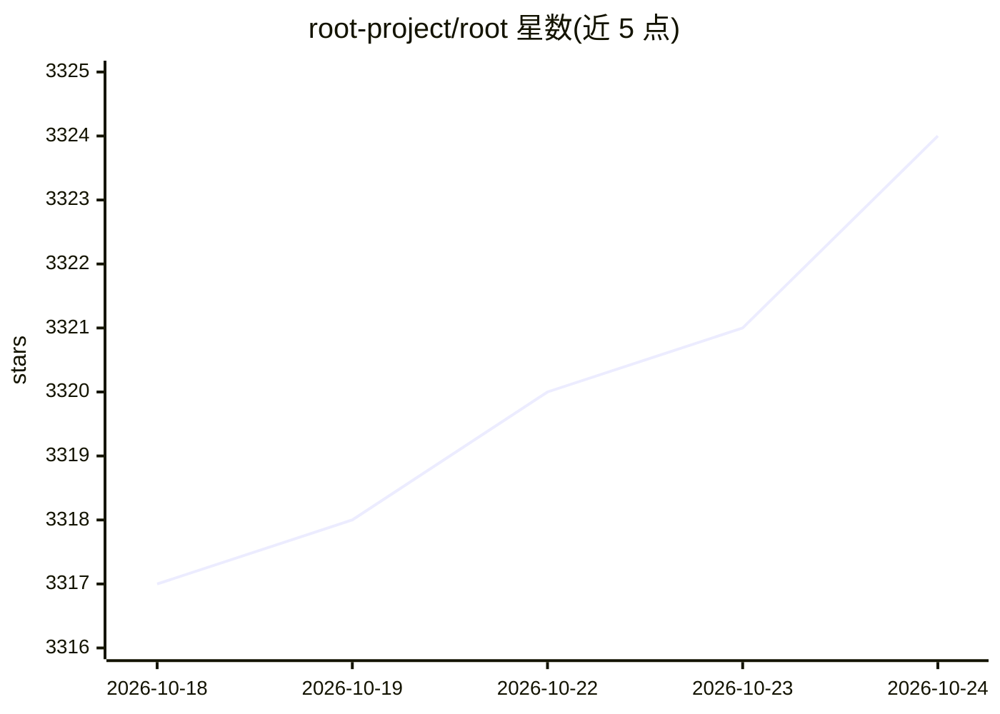

# root-project/root

⭐ 3,324 · C++ · NOASSERTION · 推送 2026-10-23 · [GitHub](https://github.com/root-project/root) · [官网](https://root.cern) · 组织维护

**科研大数据存储、处理与可视化的 C++ 分析框架**

面向高能物理等科学领域的数据分析软件包，提供列式 ROOT 格式存储系统（LHC 实验中写入 EB 级数据）、任意维直方图、曲线拟合、统计建模与最优化、交互/批处理分析，以及支持多核与分布式的 RDataFrame 并行框架。以 C++ 编写，含 C++ 解释器 Cling，并通过 cppyy 提供 C++/Python 互操作。安装方式见官网安装页，可从源码构建。

## 筛选速览

| 维度 | 判定 | 备注 |
|---|---|---|
| AI 角色 | `ai-ecosystem` | LLM/agent 周边工具 |
| 许可风险 | `none` | NOASSERTION |
| 部署形态 | `None` |  |
| 模型依赖 | — | README 未给出锁定关系 |
| 硬件要求 | — | 无带数字的原话,不猜 |
| 安装摩擦 | `low` | 无编译、无系统依赖或容器化 |
| 成熟度 | — | 结构信号不足 |

## 能力要点

- 列式 ROOT 格式存储系统，LHC 实验中存储 EB 级数据
- RDataFrame 并行处理框架，支持多核与分布式系统
- 内置 C++ 解释器 Cling 与 cppyy 动态 Python 绑定
- 任意维直方图、拟合、统计建模与最小化功能

## 适用场景

- 物理实验数据的存储、查询与批处理分析
- 在 C++/Python 混合环境中做交互式科学数据分析
- 生成可定制的论文级图表

## 场景标签

`数据分析` `科研工具` · 领域:效率与自动化

## 证据(README 行号)

> L3: ROOT is a unified software package for the storage, processing, and analysis of
> L9: ROOT provides a very efficient storage system for data models,

## 星数曲线

2026-10-18 3,317 → 2026-10-24 3,324（+7）

---
*卡片 v1 · prompt 1.4 · 生成 2026-10-20 · 置信度 low · 依据 README sha `56f4409e9ca8` · [字段定义](../../DATASET.md)*
