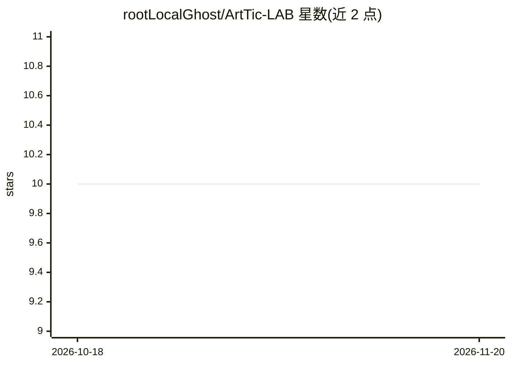

# rootLocalGhost/ArtTic-LAB

⭐ 10 · Python · NOASSERTION · 推送 2026-01-15 · [GitHub](https://github.com/rootLocalGhost/ArtTic-LAB) · [官网](https://arttic-lab.vercel.app) · 个人维护

**面向开发者与艺术家的本地 AI 图像生成平台**

基于原生 PyTorch 的硬件无关节点式生成平台，自动检测 XPU/CUDA/ROCm 并调用对应 torch 后端。加载 .safetensors 时按层键自动识别 SD1.5、SD2.1、SDXL、SD3 与 FLUX 架构，内置 SDNQ 量化与 VRAM 管理（分辨率限制与 OOM 自动清缓存），可在 8GB/12GB 显存卡上运行 FLUX.1。后端为 FastAPI+Uvicorn 加 WebSocket，UI 为无限画布节点式界面，另支持 CLI 脚本使用。

## 筛选速览

| 维度 | 判定 | 备注 |
|---|---|---|
| AI 角色 | `ai-native` | 本体是模型或模型工具 |
| 许可风险 | `none` | NOASSERTION |
| 部署形态 | `None` |  |
| 模型依赖 | — | README 未给出锁定关系 |
| 硬件要求 | `gpu-8g` | |
| 安装摩擦 | `medium` | 含编译或系统依赖之一 |
| 成熟度 | — | 结构信号不足 |

## 能力要点

- 原生 torch.xpu/cuda/hip 自动检测，无需外部编译
- 自动识别 SD1.5/SD2.1/SDXL/SD3/FLUX 架构
- SDNQ 量化与 VRAM 管理，8GB 显存可运行 FLUX.1
- 节点画布 UI + 内嵌图库（读取元数据）

## 适用场景

- 在 Intel Arc / NVIDIA / AMD 消费级显卡上本地生成图像
- 用节点画布自由搭建自己的文生图工作流
- 低显存显卡上通过量化运行 FLUX.1 等大模型

## 场景标签

`图像生成` `模型量化` · 领域:内容生成

## 证据(README 行号)

> L18: **ArtTic-LAB** is a hardware-agnostic, node-based generative AI platform built from the ground up for performance a
> L37: |**Universal Core ⚙️**|**Native XPU/CUDA/ROCm:** Auto-detects hardware and utilizes native `torch.xpu`, `torch.cuda
> L39: |**Pipeline Mastery 🧠**|**Auto-Architecture Detection:** Simply load a `.safetensors` file. The core logic analyzes

## 星数曲线

2026-10-18 10 → 2026-11-20 10（+0）

---
*卡片 v1 · prompt 1.4 · 生成 2026-11-19 · 置信度 high · 依据 README sha `4ce07afe6188` · [字段定义](../../DATASET.md)*
