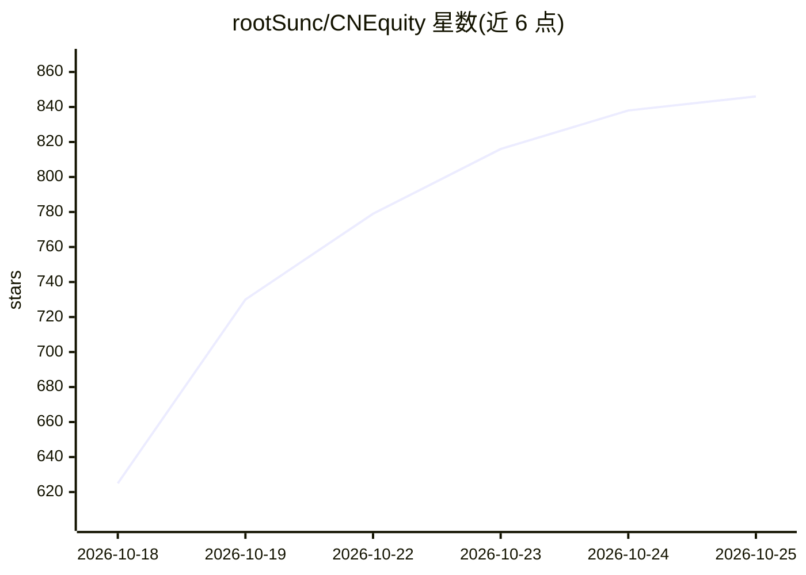

# rootSunc/CNEquity

⭐ 846 · Python · Apache-2.0 · 推送 2026-10-18 · [GitHub](https://github.com/rootSunc/CNEquity) · [官网](https://rootsunc.github.io/CNEquity/) · 个人维护 · 中文 README

**自托管中国 A 股金融数据湖，供研究与 AI Agent 本地查询**

面向个人研究者与 AI Agent 的本地金融数据基础设施：将行情、财报、资金面、事件、宏观、期货等多源数据采集为本地 Parquet 数据湖，注册 55 个数据集（47 curated + 8 derived，L0–L9 分层）。提供增量采集、失败续跑、质量审计（cne check）、行级溯源与 data_version，内置复权、PIT 语义与历史股票池（保留退市身份）。通过 Python load()/scan()、SQL、控制台（cne serve）与只读 MCP（六类工具）消费，可接入 Claude、ChatGPT、Cursor 等客户端。pip 安装，零注册零 token（部分补充来源需自备凭证）；当前 0.x 阶段，不含回测引擎与交易功能，仓库不附带数据。

## 筛选速览

| 维度 | 判定 | 备注 |
|---|---|---|
| AI 角色 | `ai-ecosystem` | LLM/agent 周边工具 |
| 许可风险 | `permissive` | Apache-2.0 |
| 部署形态 | `library` | 以包/库形式分发 |
| 模型依赖 | — | README 未给出锁定关系 |
| 硬件要求 | — | 无带数字的原话,不猜 |
| 安装摩擦 | `low` | 无编译、无系统依赖或容器化 |
| 成熟度 | `idea` | |

## 能力要点

- 55 个数据集（行情/基本面/资金面/事件/宏观/期货期权），L0–L9 分层
- 行级 source/data_version/fetched_at 溯源，严格 PIT 与历史股票池语义
- 只读 MCP 服务（六类工具）接入 Claude、ChatGPT、Cursor 等客户端
- 增量采集、失败续跑、cne check 质量验收与控制台

## 适用场景

- 长期积累 A 股历史数据并反复回测，避免幸存者偏差
- 让 Claude/ChatGPT 等 AI Agent 通过 MCP 直接查询本地行情与财报
- 按严格 PIT 口径核验某时点可见的财报信息
- 自建衍生品（期货/期权/Greeks）研究数据层

## 场景标签

`金融量化` · 领域:学习与行业

## 证据(README 行号)

> L31: **② 让 AI 直接查 A 股。** 把湖以只读方式接给 Claude、ChatGPT、Codex、Gemini CLI、Cursor、VS Code 等支持 MCP 的客户端（`--config` 用绝对路径）。以 Claud
> L205: `load()` 提供复权、PIT 和股票池语义；`scan()` 提供原始 LazyFrame。MCP 默认只读本地湖，提供描述、代码解析、行情、财报、通用数据集和 SQL 六类工具。客户端配置见 MCP 指南，查询边界见 P
> L142: - **数据留在自己手里。** 开放的 Parquet 文件，通过 Python、DuckDB、Polars、控制台和只读 MCP 消费。

## 星数曲线

2026-10-18 625 → 2026-10-25 846（+221）

---
*卡片 v1 · prompt 1.4 · 生成 2026-10-21 · 置信度 high · 依据 README sha `30f94bba90dd` · [字段定义](../../DATASET.md)*
