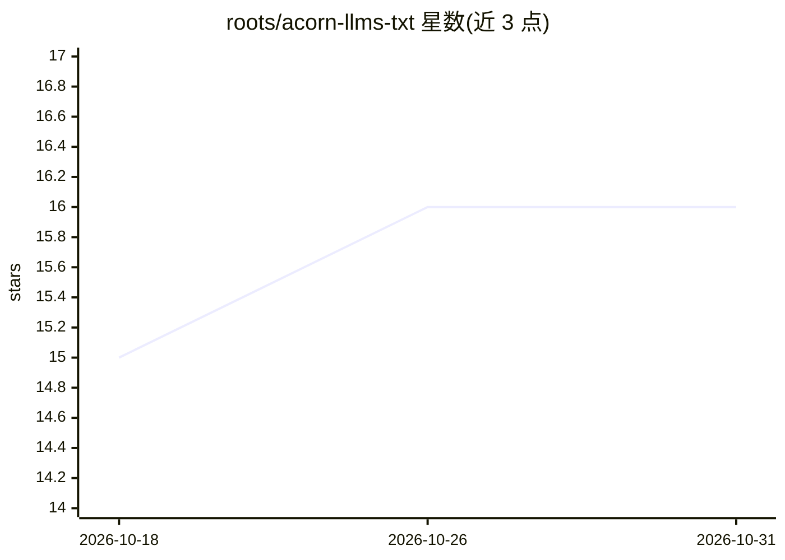

# roots/acorn-llms-txt

⭐ 16 · PHP · MIT · 推送 2026-03-21 · [GitHub](https://github.com/roots/acorn-llms-txt) · 组织维护

**为 WordPress 站点生成 llms.txt 端点，向 LLM 暴露站点内容**

基于 Acorn（Laravel on WordPress）的 Composer 包，按 llmstxt.org 规范在站点上实现 /llms.txt、/llms-full.txt、/llms-small.txt、/llms-sitemap.xml 及可选的单文章端点，将文章与页面输出为结构化 markdown 供大语言模型读取。集成 Yoast、RankMath、The SEO Framework 的 noindex 与站点地图设置，支持 WooCommerce 商品字段，内置 Laravel Cache 与自动失效，提供 WP-CLI 清缓存命令和大量开发者过滤器/动作钩子。要求 PHP 8.2+ 与带 Acorn 的 WordPress。限制：单文章端点默认关闭，内容量与文章数可配置上限。

## 筛选速览

| 维度 | 判定 | 备注 |
|---|---|---|
| AI 角色 | `ai-ecosystem` | LLM/agent 周边工具 |
| 许可风险 | `permissive` | MIT |
| 部署形态 | `None` |  |
| 模型依赖 | — | README 未给出锁定关系 |
| 硬件要求 | — | 无带数字的原话,不猜 |
| 安装摩擦 | `low` | 无编译、无系统依赖或容器化 |
| 成熟度 | — | 结构信号不足 |

## 能力要点

- 实现 llmstxt.org 规范的多种端点（listing/full/small/sitemap/单文章）
- 与 Yoast、RankMath、The SEO Framework 及 WordPress core 站点地图集成，尊重 noindex
- Laravel Cache 集成与内容变更时自动缓存失效
- 提供 WP-CLI 命令与开发者 hooks/filters 扩展点

## 适用场景

- 让自己的 WordPress 站点内容以 markdown 形式被 LLM 抓取和理解
-  WooCommerce 商店向 AI 客户端暴露商品 SKU、价格等结构化信息
- 在遵循 SEO 插件 noindex 设置的前提下控制对 LLM 暴露的内容范围

## 场景标签

 · 领域:Web/CMS 工具

## 证据(README 行号)

> L8: Expose your WordPress site content through `/llms.txt` endpoints following the llmstxt.org specification. This makes
> L16: - **llmstxt.org compliant**: Implements the standard specification for LLM-readable content

## 星数曲线

2026-10-18 15 → 2026-10-31 16（+1）

---
*卡片 v1 · prompt 1.4 · 生成 2026-10-30 · 置信度 high · 依据 README sha `202763b035a0` · [字段定义](../../DATASET.md)*
