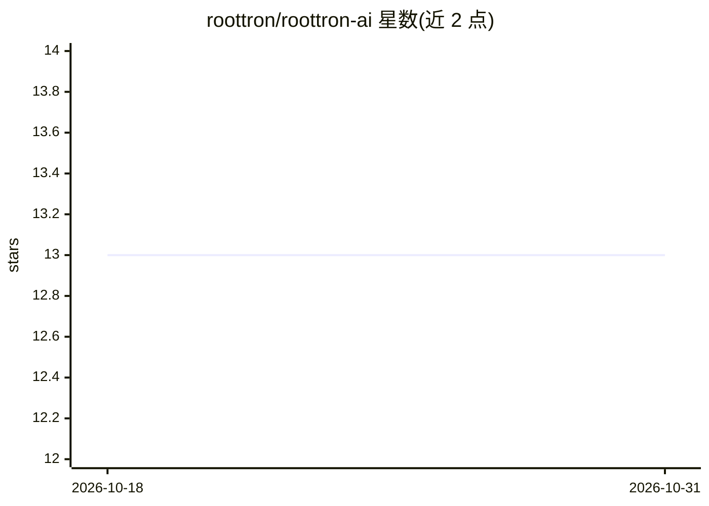

# roottron/roottron-ai

⭐ 13 · 推送 2026-09-02 · [GitHub](https://github.com/roottron/roottron-ai) · [官网](https://www.roottron.com) · 个人维护

**面向安全研究者的多 agent 网络安全 AI 助手平台**

RootTron 是一个面向安全研究人员、渗透测试者与数字取证调查者的 AI 助手应用，自称无内容过滤。采用 Hydra 多 agent 架构：输入预处理与路由后，由 RAG 检索 agent（接向量数据库）、推理 agent 与执行 agent 组成流水线。提供网络安全/默认双模式提示栏、记忆存储与调用、实时网络搜索、图像上传分析、文档摄取、积分与用户管理后台等功能，覆盖进攻、OSINT、学习、取证四种模式。前端为 Vite+React+TypeScript，后端基于 Supabase+Firebase 与 Deno Edge Functions。README 未提供安装/运行命令。

## 筛选速览

| 维度 | 判定 | 备注 |
|---|---|---|
| AI 角色 | `ai-native` | 本体是模型或模型工具 |
| 许可风险 | `none` | — |
| 部署形态 | `None` |  |
| 模型依赖 | — | README 未给出锁定关系 |
| 硬件要求 | — | 无带数字的原话,不猜 |
| 安装摩擦 | `low` | 无编译、无系统依赖或容器化 |
| 成熟度 | — | 结构信号不足 |

## 能力要点

- Hydra 多 agent 流水线（Retriever/Reasoner/Executor）
- 双模式提示栏（Default 与 Cybersecurity 模式）
- 记忆存储与动态上下文调用、实时网络搜索
- 图像上传分析与文档摄取作为私有知识库

## 适用场景

- 以对话方式获取渗透测试与漏洞利用方面的技术解答
- 上传截图或日志让 AI 分析错误与配置问题
- 安全研究与取证场景下的文档问答

## 场景标签

`多智能体` `网络安全` `AI 助手` `文档问答` · 领域:Agent 开发

## 证据(README 行号)

> L8: RootTron is not just an assistant; it is a high-performance, unrestricted intelligence engine. Engineered for elite 
> L20: ### 2. The Multi-Agent Pipeline
> L91:  - `chat`: Central unrestricted query resolution.

## 星数曲线

2026-10-18 13 → 2026-10-31 13（+0）

---
*卡片 v1 · prompt 1.4 · 生成 2026-10-31 · 置信度 mid · 依据 README sha `977b0d6fd59b` · [字段定义](../../DATASET.md)*
