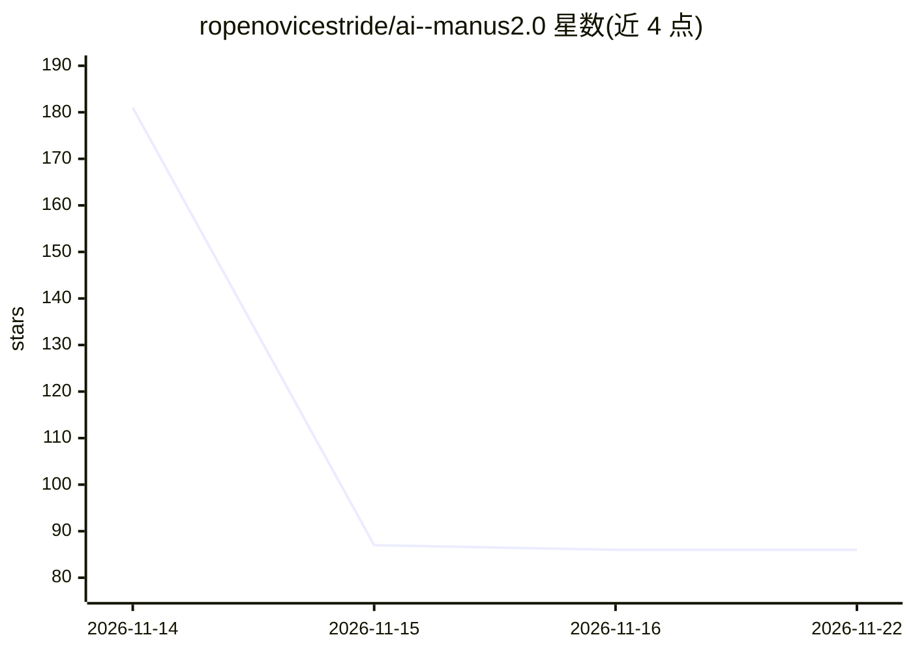

# ropenovicestride/ai--manus2.0

⭐ 86 · Apache-2.0 · 推送 2026-11-15 · [GitHub](https://github.com/ropenovicestride/ai--manus2.0) · 个人维护

**自称 Manus 自主 AI Agent：代用户写代码并控制浏览器**

README 描述一个自主 AI 代理，可自行编写并执行脚本、控制浏览器（打开页面、填写表单、收集信息），并执行多步骤日常任务，定位为面向家庭、学习与轻度办公的个人助手。文中给出系统兼容性表（最低双核 CPU / 4 GB 内存）与使用步骤说明，但全文未提供任何安装命令、源码结构、依赖清单或许可证信息；页首出现 'Download Manus' 与 'PROMO2026' 下载码，末尾附大量搜索关键词，编目时无法从 README 验证其实际代码与接入方式。

## 筛选速览

| 维度 | 判定 | 备注 |
|---|---|---|
| AI 角色 | `ai-native` | 本体是模型或模型工具 |
| 许可风险 | `permissive` | Apache-2.0 |
| 部署形态 | `None` |  |
| 模型依赖 | — | README 未给出锁定关系 |
| 硬件要求 | — | 无带数字的原话,不猜 |
| 安装摩擦 | `low` | 无编译、无系统依赖或容器化 |
| 成熟度 | — | 结构信号不足 |

## 能力要点

- 自主执行代码与浏览器控制（导航、填表、抓取信息）
- 代码与浏览器操作可在同一任务流中衔接
- 支持跨会话记忆并重复应用相同工作流
- 最低要求：64 位系统、双核 CPU、4 GB 内存

## 适用场景

- 让代理代为完成重复性的脚本执行与网页操作
- 学生整理研究资料、运行小型计算
- 轻度办公中跨多页面收集信息并汇总

## 场景标签

`AI 助手` `浏览器自动化` `编码 Agent` · 领域:效率与自动化

## 证据(README 行号)

> L10: - **Autonomous Code Execution:** Manus AI agent runs code on its own to complete tasks, so you can focus on decisio
> L18: Manus is an autonomous AI agent designed to run code and control a browser on your behalf. Instead of acting like a

## 星数曲线

2026-11-14 181 → 2026-11-22 86（-95）

---
*卡片 v1 · prompt 1.4 · 生成 2026-11-17 · 置信度 low · 依据 README sha `637da4fbcded` · [字段定义](../../DATASET.md)*
