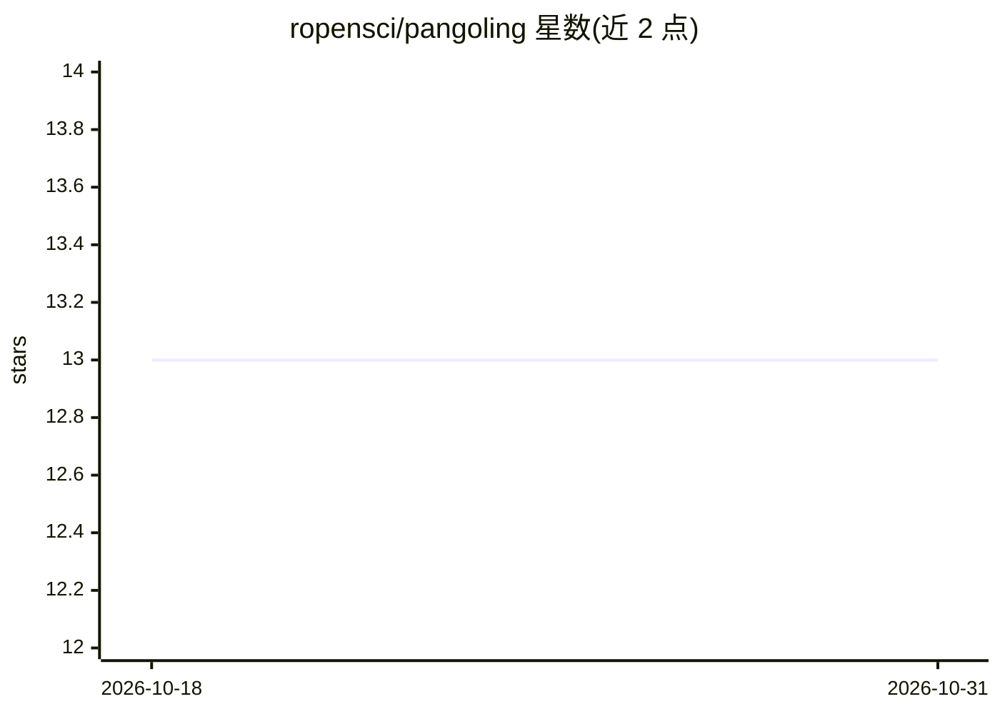

# ropensci/pangoling

⭐ 13 · R · NOASSERTION · 推送 2026-06-30 · [GitHub](https://github.com/ropensci/pangoling) · [官网](https://docs.ropensci.org/pangoling/) · 组织维护

**R 包：用 transformer 模型估计上下文中词的对数概率**

面向心理语言学研究者的 R 包，封装 Python transformers 库，在 R 环境中调用 GPT-2、BERT 等预训练 transformer 模型，输出给定上下文中各词的对数概率，常作为心理语言学研究的预测变量。通过 reticulate 管理 Python 环境，提供 install_py_pangoling 一次性安装所需 Python 依赖。README 明确提示模型训练数据未公开、含未过滤网络内容导致的偏差限制。经 rOpenSci 软件评审，发布于 CRAN。

## 筛选速览

| 维度 | 判定 | 备注 |
|---|---|---|
| AI 角色 | `ai-native` | 本体是模型或模型工具 |
| 许可风险 | `none` | NOASSERTION |
| 部署形态 | `None` |  |
| 模型依赖 | — | README 未给出锁定关系 |
| 硬件要求 | — | 无带数字的原话,不猜 |
| 安装摩擦 | `low` | 无编译、无系统依赖或容器化 |
| 成熟度 | — | 结构信号不足 |

## 能力要点

- 封装 Python transformers 库，在 R 中调用 GPT-2/BERT 等预训练模型
- causal_words_pred 等函数按句子计算每个词的对数概率
- install_py_pangoling 通过 reticulate 安装并管理 Python 依赖

## 适用场景

- 心理语言学研究中把词概率用作预测变量
- 在 R 数据分析流程中批量计算语料的词 surprisal
- 比较不同 transformer 模型给出的词可预测性

## 场景标签

`科研工具` · 领域:学习与行业

## 证据(README 行号)

> L18: `pangoling`[^1] is an R package for estimating the predictability of
> L26: The package is mostly a wrapper of the python package

## 星数曲线

2026-10-18 13 → 2026-10-31 13（+0）

---
*卡片 v1 · prompt 1.4 · 生成 2026-10-31 · 置信度 high · 依据 README sha `f31ec9db3ae9` · [字段定义](../../DATASET.md)*
