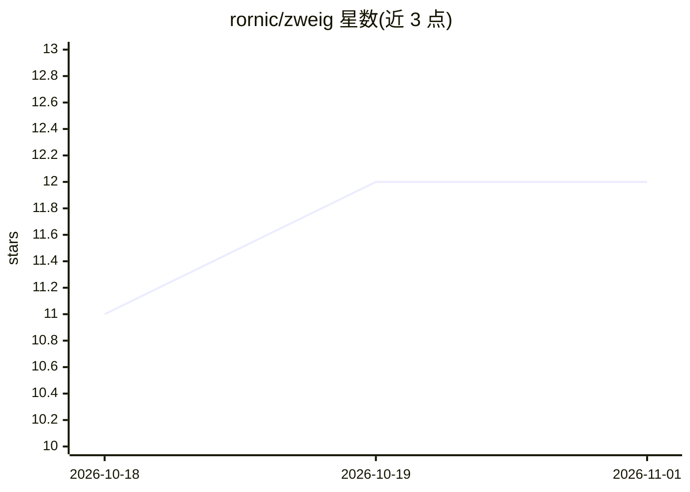

# rornic/zweig

⭐ 12 · MIT · 推送 2026-10-17 · [GitHub](https://github.com/rornic/zweig) · 个人维护

**让 Claude Code/Codex 代理按斯特凡·茨威格删减法精炼文字的技能插件**

面向 Claude Code 与 Codex 的两个写作技能：zweig-write 在代理起草任何文字（文档、PR 描述、提交信息、代码注释、Slack 消息）前自动加载，拦截套话、重复与装饰性内容；zweig-refine 对真实文件执行迭代删减，最多四轮，直至一轮零编辑，再由一个不知晓上下文的独立子代理作为『新读者』通读终稿并标记含糊或缺失之处。通过插件市场命令安装，MIT 许可。

## 筛选速览

| 维度 | 判定 | 备注 |
|---|---|---|
| AI 角色 | `ai-ecosystem` | LLM/agent 周边工具 |
| 许可风险 | `permissive` | MIT |
| 部署形态 | `None` |  |
| 模型依赖 | — | README 未给出锁定关系 |
| 硬件要求 | — | 无带数字的原话,不猜 |
| 安装摩擦 | `low` | 无编译、无系统依赖或容器化 |
| 成熟度 | — | 结构信号不足 |

## 能力要点

- zweig-write 在代理起草文字前自动加载并过滤冗余表达
- zweig-refine 对真实文件做多轮删减，最多 4 轮直至零编辑
- fresh-reader gate：独立子代理盲读终稿标记含糊之处
- 同时支持 Claude Code 与 Codex 的插件安装方式

## 适用场景

- 我写文档和 PR 描述时想让 AI 代理输出更精炼
- 对已有草稿执行多轮删减打磨
- 提交前用独立审读视角检查文字是否含糊

## 场景标签

`AI 写作` · 领域:内容生成

## 证据(README 行号)

> L13: Two writing skills for Claude Code and Codex, built on Stefan Zweig's drafting process. Write dense, then cut to in
> L31: ### `zweig-write`
> L35: ### `zweig-refine`

## 星数曲线

2026-10-18 11 → 2026-11-01 12（+1）

---
*卡片 v1 · prompt 1.4 · 生成 2026-11-01 · 置信度 high · 依据 README sha `1fca806a81e3` · [字段定义](../../DATASET.md)*
