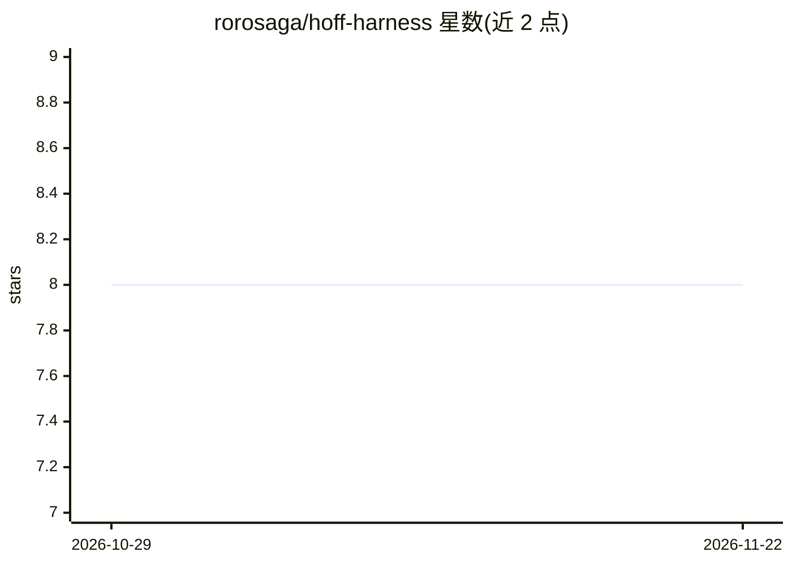

# rorosaga/hoff-harness

⭐ 8 · Python · MIT · 推送 2026-11-05 · [GitHub](https://github.com/rorosaga/hoff-harness) · [官网](https://hoff.rorosaga.com) · 个人维护

**为编码 agent 提供的 macOS 指引光标：圈选讲解与代操作**

运行于 macOS 的辅助工具，为 Claude Code、Codex、Cursor 等可执行 shell 命令的 agent 提供可视化光标层：光标滑向屏幕元素、气泡讲解、分步引导用户点击，或代替用户点击输入。用户按住 ⌃⌥ 圈选屏幕内容，标记连同截图附到消息发送给 agent；在 Chrome 中可操作页面元素。通过 accessibility API 与 AppKit 实现，经 SKILL.md 或 Claude 插件方式接入 agent，数据保留在本地并在一天后删除。

## 筛选速览

| 维度 | 判定 | 备注 |
|---|---|---|
| AI 角色 | `ai-ecosystem` | LLM/agent 周边工具 |
| 许可风险 | `permissive` | MIT |
| 部署形态 | `None` |  |
| 模型依赖 | — | README 未给出锁定关系 |
| 硬件要求 | — | 无带数字的原话,不猜 |
| 安装摩擦 | `low` | 无编译、无系统依赖或容器化 |
| 成熟度 | — | 结构信号不足 |

## 能力要点

- ⌃⌥ 圈选屏幕元素并附截图发给 agent
- 展示、分步引导、代操作、屏幕讲解四种交互模式
- 经 Claude 插件市场或 git clone + SKILL.md 软链接接入多 agent
- 通过本地 socket 与悬浮层通信，不抢占焦点

## 适用场景

- 让 agent 指出应用界面中的按钮位置并讲解
- 让 agent 分步带我完成配置任务
- 圈选报错内容让 agent 分析原因
- 让 agent 代为执行系统设置操作并演示过程

## 场景标签

`GUI 自动化` · 领域:效率与自动化

## 证据(README 行号)

> L12: **macOS only.** Works with Claude Code, Cursor, the Claude desktop app (MCP), Codex,
> L64: - **macOS 14 or later.** It uses the macOS accessibility API and AppKit
> L79:   agent's shell                          overlay (starts with your agent session)

## 星数曲线

2026-10-29 8 → 2026-11-22 8（+0）

---
*卡片 v1 · prompt 1.4 · 生成 2026-11-20 · 置信度 high · 依据 README sha `116e0d9292c5` · [字段定义](../../DATASET.md)*
