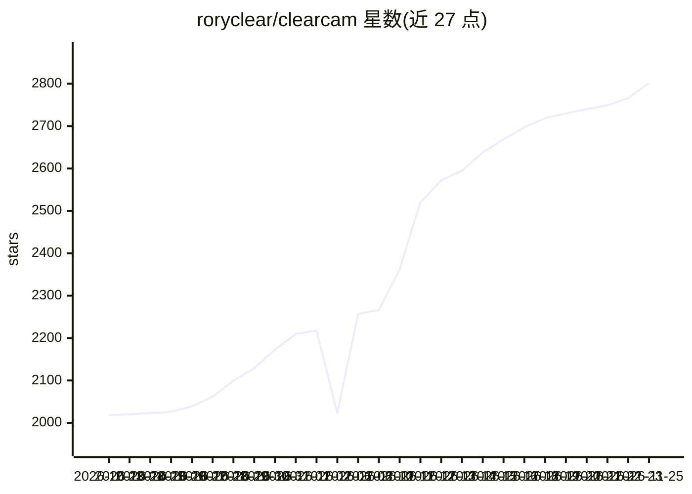

# roryclear/clearcam

⭐ 2,802 · Python · GPL-3.0 · 推送 2026-11-23 · [GitHub](https://github.com/roryclear/clearcam) · [官网](https://clearcam.org) · 个人维护

**为任意 RTSP 安防摄像头添加目标检测、追踪与通知**

自托管 NVR 系统：接入 RTSP 摄像头流，运行目标检测与追踪（含 Qwen3 VL 的 AI 通知摘要），支持区域（Zone）配置、事件片段、浏览器 Web Push 通知及可自定义的通知推送目标（Home Assistant、Pushover、N8N 等）。服务端以 Python 从源码运行，支持 AMD/NVIDIA GPU 后端与 BEAM 编译选项；另有 iOS/Android 应用用于远程查看直播、接收通知与片段，付费 Premium 提供端到端加密的远程访问。Windows 需 ffmpeg 修复。

## 筛选速览

| 维度 | 判定 | 备注 |
|---|---|---|
| AI 角色 | `ai-native` | 本体是模型或模型工具 |
| 许可风险 | `viral` | GPL-3.0 |
| 部署形态 | `library` | 以包/库形式分发 |
| 模型依赖 | — | README 未给出锁定关系 |
| 硬件要求 | — | 无带数字的原话,不猜 |
| 安装摩擦 | `medium` | 含编译或系统依赖之一 |
| 成熟度 | — | 结构信号不足 |

## 能力要点

- 对任意 RTSP 摄像头流做目标检测、追踪与事件搜索
- Qwen3 VL 生成的 AI 通知摘要
- 浏览器 Web Push 通知（Vapid key 配置）及自定义通知 URL
- 服务端支持 AMD/NVIDIA GPU 后端与 BEAM 性能选项

## 适用场景

- 给现有 RTSP 摄像头自托管添加检测与通知
- 通过 Home Assistant 或 Pushover 接收人员/物体检测告警
- 用 iOS/Android 应用远程查看摄像头直播与事件片段

## 场景标签

`目标检测` · 领域:感知与多模态

## 证据(README 行号)

> L3: # clearcam: Add object detection, tracking, mobile notifications, AI summaries, and search to any security camera.
> L41: ## run NVR + inference in python from source

## 星数曲线

2026-10-23 2,018 → 2026-11-25 2,802（+784）

---
*卡片 v1 · prompt 1.4 · 生成 2026-11-23 · 置信度 high · 依据 README sha `398a4a6f3048` · [字段定义](../../DATASET.md)*
