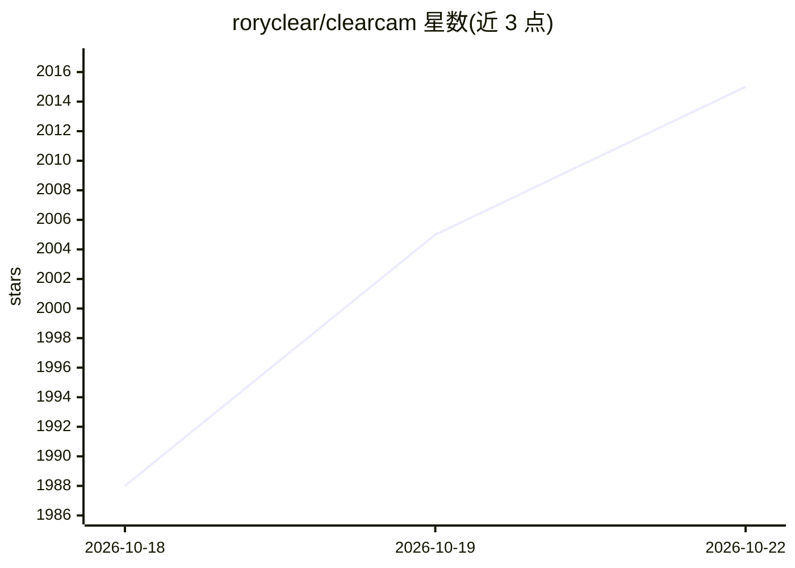

# roryclear/clearcam

⭐ 2,015 · Python · GPL-3.0 · 推送 2026-10-19 · [GitHub](https://github.com/roryclear/clearcam) · [官网](https://clearcam.org) · 个人维护

**给任意 RTSP 摄像头加目标检测、追踪与搜索的自托管 NVR**

自托管的安防摄像头视频分析系统：读取 RTSP 等视频流，运行目标检测与追踪（tinygrad/YOLOv9），配合 iOS/Android 应用提供远程实时查看、事件通知、事件片段回放与端到端加密；支持区域（Zone）检测、可自定义通知接收 URL（Home Assistant、Pushover、N8N 等），并含基于 Qwen3 VL 的 AI 通知摘要。服务器端以 Python 源码运行，需要 ffmpeg 与 Python 3.11+，Mac/Linux 可用（Windows 需修复 ffmpeg 问题），可选 AMD/NV GPU 加速。付费 Premium 服务提供远程串流与通知。

## 筛选速览

| 维度 | 判定 | 备注 |
|---|---|---|
| AI 角色 | `ai-native` | 本体是模型或模型工具 |
| 许可风险 | `viral` | GPL-3.0 |
| 部署形态 | `library` | 以包/库形式分发 |
| 模型依赖 | — | README 未给出锁定关系 |
| 硬件要求 | — | 无带数字的原话,不猜 |
| 安装摩擦 | `medium` | 含编译或系统依赖之一 |
| 成熟度 | — | 结构信号不足 |

## 能力要点

- 对任意 RTSP/网络摄像头流运行目标检测与追踪
- 区域检测与可自定义通知 URL（Home Assistant/Pushover/N8N）
- Qwen3 VL 生成 AI 通知摘要
- iOS/Android 客户端，端到端加密，事件片段远程查看

## 适用场景

- 给家里或店面的 RTSP 摄像头加人员/物体检测告警
- 自托管 NVR 替代云端录像，本地推理保护隐私
- 接入 Home Assistant 等家庭自动化系统联动通知

## 场景标签

`目标检测` · 领域:感知与多模态

## 证据(README 行号)

> L3: # clearcam: Add object detection, tracking, mobile notifications, AI summaries, and search to any security camera.
> L12:  *NEW* AI Notification Summaries with Qwen3 VL

## 星数曲线

2026-10-18 1,988 → 2026-10-22 2,015（+27）

---
*卡片 v1 · prompt 1.4 · 生成 2026-10-21 · 置信度 mid · 依据 README sha `d18322e27bc0` · [字段定义](../../DATASET.md)*
