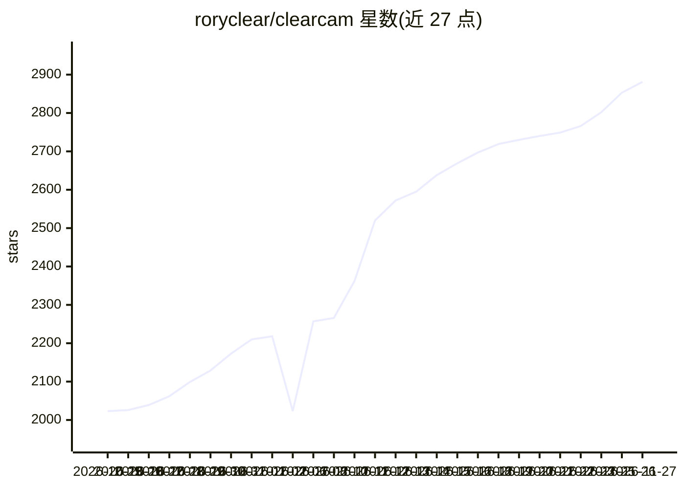

# roryclear/clearcam

⭐ 2,881 · Python · GPL-3.0 · 推送 2026-11-26 · [GitHub](https://github.com/roryclear/clearcam) · [官网](https://clearcam.org) · 个人维护

**给任意 RTSP 监控摄像头添加目标检测、追踪与通知的 NVR**

自托管 NVR 软件：对 RTSP 摄像头画面运行目标检测与追踪，生成事件通知与剪辑，支持 AI 通知摘要（Qwen3 VL）与搜索。服务器端通过 Python 从源码运行，浏览器访问 localhost:8080；可通过 Web Push（VAPID）或自定义 URL 对接 Home Assistant、Pushover、N8N 等接收通知。提供 iOS/Android 应用用于远程查看实时画面、事件剪辑与接收通知（premium 功能）。Windows 需 ffmpeg 修复，未正式支持。

## 筛选速览

| 维度 | 判定 | 备注 |
|---|---|---|
| AI 角色 | `ai-native` | 本体是模型或模型工具 |
| 许可风险 | `viral` | GPL-3.0 |
| 部署形态 | `library` | 以包/库形式分发 |
| 模型依赖 | — | README 未给出锁定关系 |
| 硬件要求 | — | 无带数字的原话,不猜 |
| 安装摩擦 | `medium` | 含编译或系统依赖之一 |
| 成熟度 | — | 结构信号不足 |

## 能力要点

- 对任意 RTSP 摄像头运行目标检测与追踪（YOLOv9/tinygrad）
- AI 通知摘要（Qwen3 VL）与事件搜索
- 浏览器 Web Push 通知及自定义通知 URL（Home Assistant/Pushover/N8N）
- iOS/Android 应用远程查看实时画面与事件剪辑

## 适用场景

- 给现有 RTSP 摄像头添加检测与通知功能
- 自托管监控，接 Home Assistant 自定义告警
- 手机远程查看摄像头画面与事件剪辑

## 场景标签

`目标检测` `语义搜索` · 领域:知识与检索

## 证据(README 行号)

> L3: # clearcam: Add object detection, tracking, mobile notifications, AI summaries, and search to any security camera.
> L41: ## run NVR + inference in python from source
> L46: - use DEV=AMD / DEV=NV python3.12 clearcam.py if your CPU is being used instead of your GPU

## 星数曲线

2026-10-25 2,023 → 2026-11-27 2,881（+858）

---
*卡片 v1 · prompt 1.4 · 生成 2026-11-26 · 置信度 high · 依据 README sha `4c5141859f57` · [字段定义](../../DATASET.md)*
