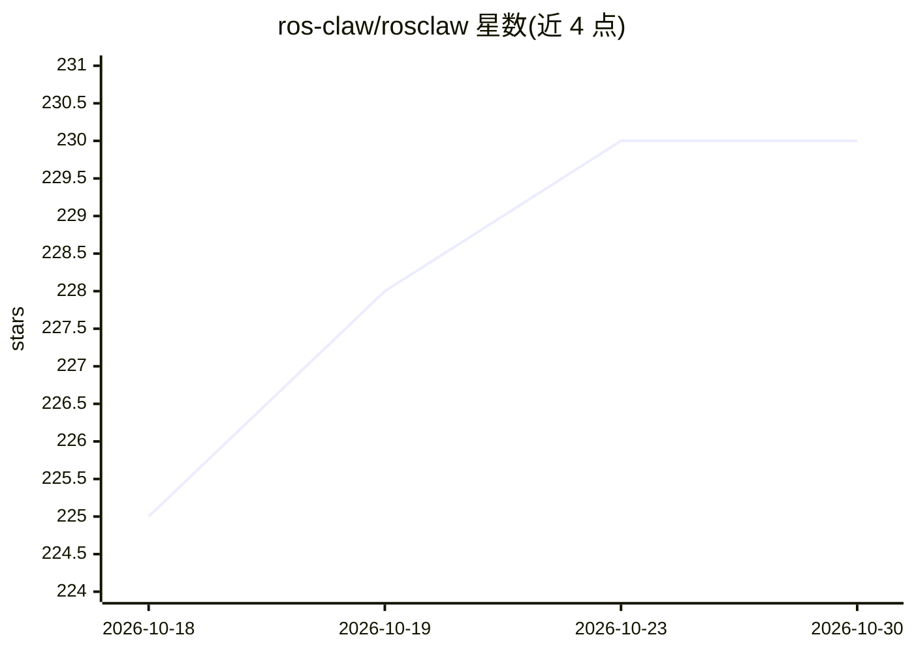

# ros-claw/rosclaw

⭐ 230 · Python · MIT · 推送 2026-10-29 · [GitHub](https://github.com/ros-claw/rosclaw) · [官网](https://rosclaw.io) · 组织维护 · 中文 README

**具身智能体运行时：把 Agent 意图转为受治理的物理动作与经验**

ROSClaw 是面向具身 Agent 的 Physical AI 运行时，位于上层 Agent（Codex、Claude Code、OpenClaw、VLAs 等）与下层硬件（ROS 2、MCP、仿真器、厂商 SDK、机器人）之间。核心机制：意图绑定 Body 与能力后经策略/授权仲裁，分发到驱动并返回带证据的 ExecutionReceipt；记忆与技能演化作为证据的异步消费方。由同济大学与上海智能自主系统研究院研发。自述为 alpha 软件，多数硬件路径为仿真验证或实验状态；提供离线 tar 包与 PyPI wheel 两种安装形式，后者需宿主机 Node.js ≥ 22.19。

## 筛选速览

| 维度 | 判定 | 备注 |
|---|---|---|
| AI 角色 | `ai-ecosystem` | LLM/agent 周边工具 |
| 许可风险 | `permissive` | MIT |
| 部署形态 | `library` | 以包/库形式分发 |
| 模型依赖 | — | README 未给出锁定关系 |
| 硬件要求 | — | 无带数字的原话,不猜 |
| 安装摩擦 | `low` | 无编译、无系统依赖或容器化 |
| 成熟度 | `idea` | |

## 能力要点

- 意图→Body→授权→动作→回执（ExecutionReceipt）的受治理执行链
- 六种执行模式（FIXTURE/DRY_RUN/REPLAY/SIMULATION/SHADOW/REAL）区分成熟度
- rosclawd 守护进程提供 permit、lease、E-Stop、审计账本等控制面边界
- UR5e/Turtlesim+Gazebo 等路径已在仿真中系统验证

## 适用场景

- 让 Codex/Claude Code 等 Agent 通过 MCP 安全驱动机器人或仿真器
- 在物理动作前施加策略授权与资源仲裁
- 把验证过的物理执行经验沉淀为记忆与可复用技能

## 场景标签

 · 领域:机器人/具身智能基础设施

## 证据(README 行号)

> L20: ROSClaw connects **AI agents and the physical world**. It turns agent intent
> L56: ROSClaw is the **Physical AI Runtime for Embodied Agents**: a bidirectional

## 星数曲线

2026-10-18 225 → 2026-10-30 230（+5）

---
*卡片 v1 · prompt 1.4 · 生成 2026-10-22 · 置信度 high · 依据 README sha `4a8c6f55908f` · [字段定义](../../DATASET.md)*
