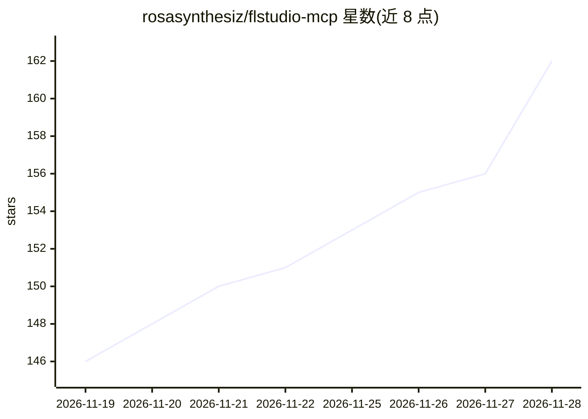

# rosasynthesiz/flstudio-mcp

⭐ 162 · Python · MIT · 推送 2026-11-26 · [GitHub](https://github.com/rosasynthesiz/flstudio-mcp) · [官网](https://rosasynthesiz.com/products/fl-studio-mcp) · 个人维护

**用 Claude 等 AI 助手以自然语言控制 FL Studio 的 MCP 服务器**

一个连接 FL Studio 与 AI 助手（Claude Code、Claude Desktop、Cursor、Codex 等 MCP 客户端）的 MCP 服务器，通过 FL 脚本 API 与虚拟 MIDI 端口通信，提供 96 个工具覆盖混音诊断、增益、插件参数、钢琴卷帘、鼓机、playlist、路由与撤销。每次修改经快照→写入→回读→回滚的安全层，均可撤销。macOS 一条命令安装；Windows 需 loopMIDI。限制来自 FL API：无法加载插件/音频文件，音频导出须手动。

## 筛选速览

| 维度 | 判定 | 备注 |
|---|---|---|
| AI 角色 | `ai-ecosystem` | LLM/agent 周边工具 |
| 许可风险 | `permissive` | MIT |
| 部署形态 | `desktop` | 安装包/桌面程序 |
| 模型依赖 | — | README 未给出锁定关系 |
| 硬件要求 | — | 无带数字的原话,不猜 |
| 安装摩擦 | `low` | 无编译、无系统依赖或容器化 |
| 成熟度 | — | 结构信号不足 |

## 能力要点

- 96 个工具覆盖混音、插件、钢琴卷帘、步进音序器与路由
- Mix Doctor 扫描混音并给出逐项证据与建议修复
- 所有修改可撤销，写参数带 verified 回读校验
- 音频分析：速度/调性估计、旋律与和弦转 MIDI、鼓转 MIDI

## 适用场景

- 让 AI 扫描并诊断我的混音问题
- 用自然语言配置人声链路和插件参数
- 把旋律或和弦音频转成 MIDI 导入钢琴卷帘

## 场景标签

 · 领域:音频/音乐制作工具

## 证据(README 行号)

> L20: `flstudio-mcp` is a Model Context Protocol (MCP) server that connects FL Studio to AI assistants: Claude Code, Clau
> L22: - **96 tools** for the mixer, plugins, piano roll, step sequencer, patterns, playlist, routing and transport

## 星数曲线

2026-11-19 146 → 2026-11-28 162（+16）

---
*卡片 v1 · prompt 1.4 · 生成 2026-11-27 · 置信度 high · 依据 README sha `672d3220ff82` · [字段定义](../../DATASET.md)*
