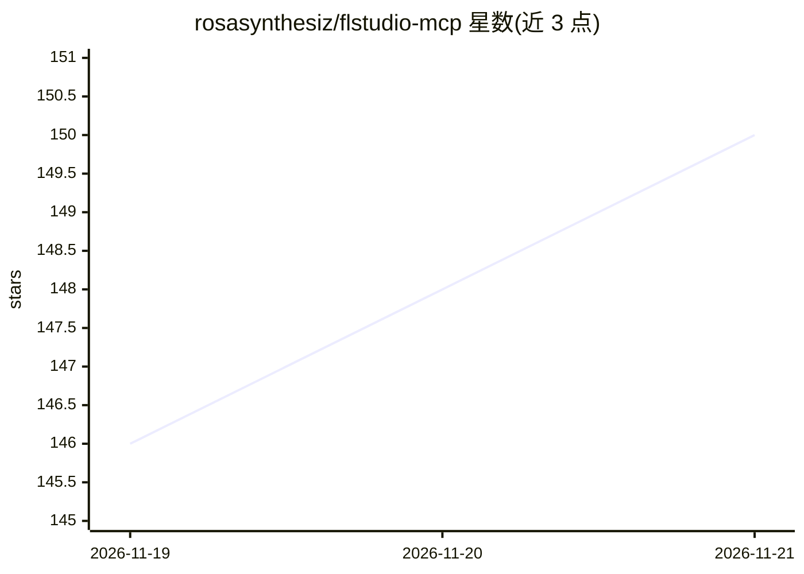

# rosasynthesiz/flstudio-mcp

⭐ 150 · Python · MIT · 推送 2026-11-18 · [GitHub](https://github.com/rosasynthesiz/flstudio-mcp) · 个人维护

**用 Claude 等 AI 助手通过自然语言控制 FL Studio 的 MCP 服务器**

一个连接 FL Studio 与 AI 助手（Claude Code、Claude Desktop、Cursor、Codex 或任意 MCP 客户端）的 MCP 服务器，通过 FL 的 scripting API 与虚拟 MIDI 端口暴露 90 个工具和 6 个实时资源，覆盖混音诊断（Mix Doctor）、增益分级、插件参数控制、钢琴卷帘写作、鼓机步骤、播放列表与路由等；每项变更可撤销并经快照→写入→回读→回滚的安全层。macOS 一条命令安装，Windows 需 loopMIDI；音频导出、插件加载等仍需手动操作（FL API 限制）。

## 筛选速览

| 维度 | 判定 | 备注 |
|---|---|---|
| AI 角色 | `ai-ecosystem` | LLM/agent 周边工具 |
| 许可风险 | `permissive` | MIT |
| 部署形态 | `desktop` | 安装包/桌面程序 |
| 模型依赖 | locked-api |  |
| 硬件要求 | — | 无带数字的原话,不猜 |
| 安装摩擦 | `low` | 无编译、无系统依赖或容器化 |
| 成熟度 | — | 结构信号不足 |

## 能力要点

- 90 个工具 + 6 个可被客户端直接读取的实时资源（项目、混音器、走带等）
- Mix Doctor 扫描混音并给出带证据的具体问题与可撤销的修复
- 音频分析：速度/调性估计、旋律与和弦转 MIDI（CREPE、Basic Pitch）、鼓转 MIDI
- macOS 一条命令安装并自动创建 MIDI 端口，无需 MIDI 配置

## 适用场景

- 在 FL Studio 里用自然语言让 AI 诊断并修复混音问题
- 让 AI 生成音阶/和弦进行并写入钢琴卷帘或导出 MIDI
- 读取并批量设置原生与第三方插件参数，一步撤销

## 场景标签

 · 领域:音乐制作工具/AI 助手集成

## 证据(README 行号)

> L18: `flstudio-mcp` is a Model Context Protocol (MCP) server that connects FL Studio to AI assistants: Claude Code, Clau
> L116: - **Claude Code**, **Claude Desktop**, Cursor, Codex or any MCP client

## 星数曲线

2026-11-19 146 → 2026-11-21 150（+4）

---
*卡片 v1 · prompt 1.4 · 生成 2026-11-19 · 置信度 mid · 依据 README sha `abf3351acc91` · [字段定义](../../DATASET.md)*
