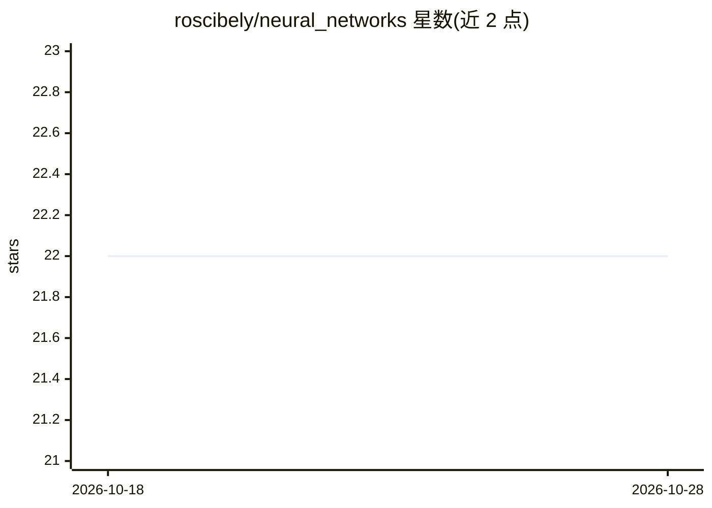

# roscibely/neural_networks

⭐ 22 · Python · GPL-3.0 · 推送 2026-10-19 · [GitHub](https://github.com/roscibely/neural_networks) · 组织维护

**神经网络课程的讲义资源仓库（UFERSA 本科）**

UFERSA 计算机工程专业的神经网络课程（PEX0023）配套 GitHub 仓库，由授课教师维护。README 以课程大纲为主体，覆盖三个教学单元：感知机/MLP/Backpropagation/RBF 等基础网络、深度学习（正则化/CNN/可解释 AI）、RNN/LSTM/GRU/NLP/Transformers；另附实践项目（分类回归、AWS DeepRacer）、框架列举（TensorFlow/PyTorch/Keras 等）、数据集仓库、工具与参考书目链接。无代码安装说明，属教学资源集合。

## 筛选速览

| 维度 | 判定 | 备注 |
|---|---|---|
| AI 角色 | `ai-knowledge` | 知识聚合/清单类 |
| 许可风险 | `viral` | GPL-3.0 |
| 部署形态 | `None` |  |
| 模型依赖 | — | README 未给出锁定关系 |
| 硬件要求 | — | 无带数字的原话,不猜 |
| 安装摩擦 | `low` | 无编译、无系统依赖或容器化 |
| 成熟度 | — | 结构信号不足 |

## 能力要点

- 三单元课程大纲：从感知机到 Transformers
- 实践与项目含分类回归及 AWS DeepRacer
- 汇集框架、数据集仓库、工具与参考书目链接

## 适用场景

- 跟随课程大纲学习神经网络基础到深度学习
- 查找神经网络教材与数据集入口
- 作为本科课程的教学资料索引

## 场景标签

`教程课程` · 领域:学习与行业

## 证据(README 行号)

> L1: # Redes Neurais Artificiais (RNA)
> L5: ### PEX0023 - REDES NEURAIS ARTIFICIAIS
> L6: #### Bacharelado em Engenharia de Computação - UFERSA

## 星数曲线

2026-10-18 22 → 2026-10-28 22（+0）

---
*卡片 v1 · prompt 1.4 · 生成 2026-10-27 · 置信度 high · 依据 README sha `e1e515f49d7c` · [字段定义](../../DATASET.md)*
