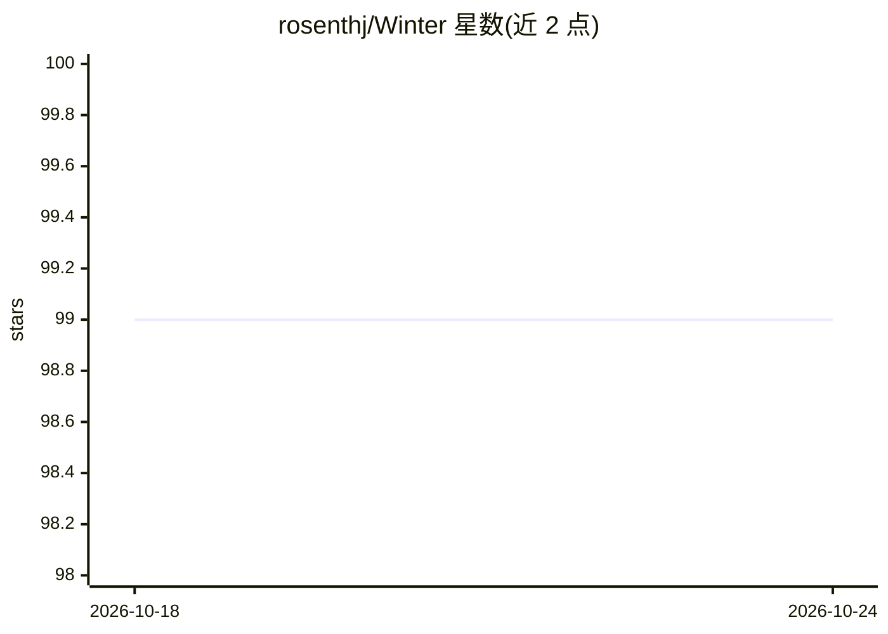

# rosenthj/Winter

⭐ 99 · C++ · GPL-3.0 · 推送 2026-10-01 · [GitHub](https://github.com/rosenthj/Winter) · 个人维护

**UCI 国际象棋引擎：搜索加小型神经网络评估对局**

用 C++ 从零实现、无外部依赖（仅 STL）的 UCI 国际象棋引擎，曾在 TCEP、Chess.com Computer Championships 等赛事参赛。评估函数依赖小型神经网络，开发历程中使用过 Gaussian Mixture Models、Soft K-Means 等聚类方法。提供基于胜/和/负概率的 contempt 实现与 Armageddon 模式（v0.8.1 起禁用），并给出从 PGN 棋谱生成数据集、自行训练评估网络的有限流程。安装需源码编译（make），支持 Android 交叉编译。

## 筛选速览

| 维度 | 判定 | 备注 |
|---|---|---|
| AI 角色 | `ai-native` | 本体是模型或模型工具 |
| 许可风险 | `viral` | GPL-3.0 |
| 部署形态 | `None` |  |
| 模型依赖 | — | README 未给出锁定关系 |
| 硬件要求 | — | 无带数字的原话,不猜 |
| 安装摩擦 | `low` | 无编译、无系统依赖或容器化 |
| 成熟度 | `idea` | |

## 能力要点

- 评估函数依赖小型神经网络，算法全部从零实现
- 基于胜/和/负概率的 contempt 实现与 Armageddon UCI 选项
- 提供 PGN→CSV 数据集→训练自用网络的流程
- 无外部库依赖（仅 STL），支持 Linux 与 Android 编译

## 适用场景

- 接入 UCI 兼容 GUI 或赛事平台进行对局分析
- 研究神经网络评估与传统搜索结合的象棋引擎
- 用自有棋谱训练自定义评估网络

## 场景标签

 · 领域:博弈/棋类引擎

## 证据(README 行号)

> L6: Winter has relied on many machine learning algorithms and techniques over the course of its development. This includ
> L8: As of Winter 0.6.2, the evaluation function relies on a small neural network for more precise evaluations.

## 星数曲线

2026-10-18 99 → 2026-10-24 99（+0）

---
*卡片 v1 · prompt 1.4 · 生成 2026-10-23 · 置信度 high · 依据 README sha `b2d83f2434b9` · [字段定义](../../DATASET.md)*
