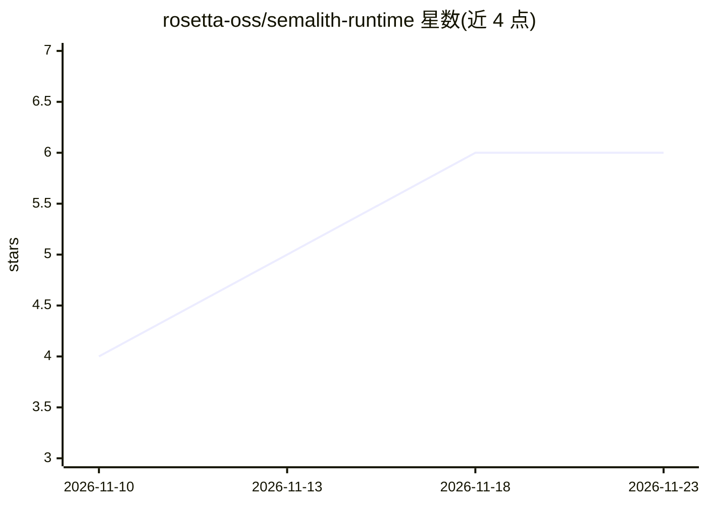

# rosetta-oss/semalith-runtime

⭐ 6 · NOASSERTION · 推送 2026-11-07 · [GitHub](https://github.com/rosetta-oss/semalith-runtime) · [官网](https://github.com/rosetta-oss/semalith-runtime#quick-start) · 组织维护

**面向 AI agent 的语义层：本体+知识库+MCP 工具**

Semalith Runtime 以 Docker 镜像发布（仓库不含源码），在数据与 AI agent 之间提供语义层：用户以精简本体（实体、关系、指标、规则、动作）描述业务，辅以经审核的知识库，agent 通过 12 个固定 MCP 工具查询，回答附带定义与边界。附带一键 ERP 演示（加载 AdventureWorks 样例数据）与基准测试：同一 agent 经 REST、图、图+知识库三条路径回答 44 个业务问题各三次。需 Docker Compose v2 与约 3 GB 内存，连接 Claude Code、Codex 等客户端。许可证为免费试用/研究许可，商业与生产用途需书面许可。

## 筛选速览

| 维度 | 判定 | 备注 |
|---|---|---|
| AI 角色 | `ai-ecosystem` | LLM/agent 周边工具 |
| 许可风险 | `none` | NOASSERTION |
| 部署形态 | `self-host` | docker 或自建部署 |
| 模型依赖 | locked-api |  |
| 硬件要求 | — | 无带数字的原话,不猜 |
| 安装摩擦 | `low` | 无编译、无系统依赖或容器化 |
| 成熟度 | `idea` | |

## 能力要点

- 以 MCP 提供 12 个固定工具供 agent 查询本体与知识库
- 规则、行级安全与动作在本体中执行，知识库承载业务语境
- 读取现有数据库与 API，无需数据迁移
- 附带 ERP 演示与 REST/图/图+知识库三路径基准测试

## 适用场景

- 让 AI agent 用业务语义而非裸表查询企业数据
- 为 agent 接入带规则与行级安全的数据查询通道
- 通过 Builder 用 AI 构建和修改本体图

## 场景标签

`知识图谱` `知识库管理` · 领域:知识与检索

## 证据(README 行号)

> L3: **The semantic layer between your data and AI agents.**
> L9: Semalith gives AI agents your business meaning, not just your tables. You describe the business once as a lean ontol
> L36: - **Standard tools.** Agents use 12 fixed MCP tools. New business needs change the graph, not the tools.

## 星数曲线

2026-11-10 4 → 2026-11-23 6（+2）

---
*卡片 v1 · prompt 1.4 · 生成 2026-11-20 · 置信度 high · 依据 README sha `231ff1bbc38c` · [字段定义](../../DATASET.md)*
