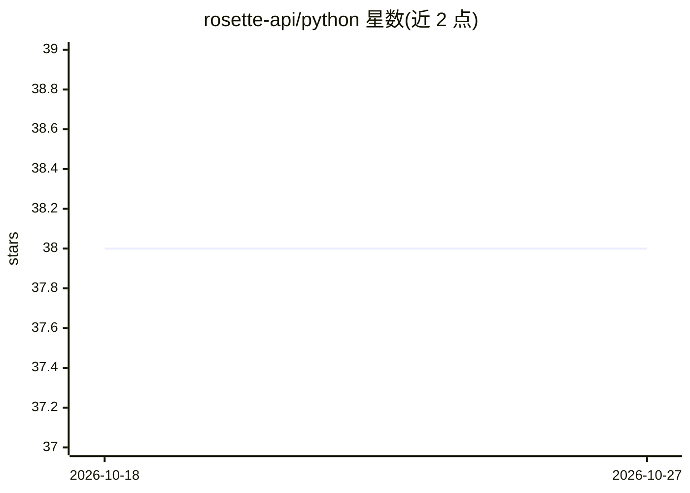

# rosette-api/python

⭐ 38 · Python · NOASSERTION · 推送 2026-10-05 · [GitHub](https://github.com/rosette-api/python) · 组织维护

**Babel Street Analytics（文本分析）Python 客户端库**

Babel Street Analytics（原 Rosette）的官方 Python 客户端库，通过 API 访问云端文本分析服务：语言识别、词形还原、实体与事件抽取、语义相似搜索、情感分析与主题抽取等 NLP 能力，并提供领域事件模型训练辅助工具。面向需要将该分析服务集成到 Python 应用的开发者，需注册 Analytics Cloud 账户获取 API 访问。绑定库以 Apache 2.0 许可发布，examples 目录含各端点示例。

## 筛选速览

| 维度 | 判定 | 备注 |
|---|---|---|
| AI 角色 | `ai-ecosystem` | LLM/agent 周边工具 |
| 许可风险 | `permissive` | NOASSERTION |
| 部署形态 | `library` | 以包/库形式分发 |
| 模型依赖 | — | README 未给出锁定关系 |
| 硬件要求 | — | 无带数字的原话,不猜 |
| 安装摩擦 | `low` | 无编译、无系统依赖或容器化 |
| 成熟度 | — | 结构信号不足 |

## 能力要点

- 覆盖语言识别、实体/事件抽取、语义相似、情感分析等端点
- 通过 Analytics Cloud API 访问服务
- examples 目录提供各端点示例程序
- 绑定库 Apache 2.0 许可

## 适用场景

- 在 Python 应用中调用 Babel Street 文本分析 API
- 对非结构化文本做实体与事件抽取
- 跨语言语义相似搜索与文本规范化处理

## 场景标签

`语义搜索` · 领域:知识与检索

## 证据(README 行号)

> L10: Our product is a full text processing pipeline from data preparation to extracting the most relevant information an
> L23: ## Analytics API Access

## 星数曲线

2026-10-18 38 → 2026-10-27 38（+0）

---
*卡片 v1 · prompt 1.4 · 生成 2026-10-25 · 置信度 high · 依据 README sha `84f7335406f1` · [字段定义](../../DATASET.md)*
