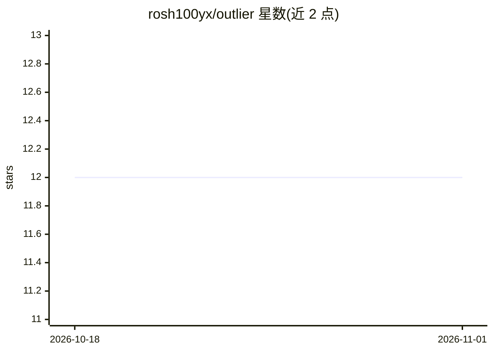

# rosh100yx/outlier

⭐ 12 · TypeScript · MIT · 推送 2026-07-04 · [GitHub](https://github.com/rosh100yx/outlier) · [官网](https://www.npmjs.com/package/outlier-audit) · 个人维护

**本地优先的 AI 代码治理 CLI：测量代码中 AI 占比、成本与风险**

面向开发者的本地优先命令行审计工具：读取 git 历史与本地 AI 会话转录（如 Claude Code 日志），按 blame 与内容匹配计算 AI 执行占比、提示意图、审查监督三轴并给出 Artisan/Centaur 等标签；同时统计 token 成本、碳足迹估算、agent 可达范围与爆炸半径评分，可通过 outlier watch 按文件变更无差别捕获 Cursor/Copilot/Aider 等工具的产出。支持 git pre-commit 钩子在 AI 占比超限时告警、--json 输出供 CI 使用。全程不联网、无遥测；无日志时对执行占比标注 Unmeasured 而非猜测，碳排与部分成本为标注的粗略估算。

## 筛选速览

| 维度 | 判定 | 备注 |
|---|---|---|
| AI 角色 | `ai-ecosystem` | LLM/agent 周边工具 |
| 许可风险 | `permissive` | MIT |
| 部署形态 | `library` | 以包/库形式分发 |
| 模型依赖 | — | README 未给出锁定关系 |
| 硬件要求 | — | 无带数字的原话,不猜 |
| 安装摩擦 | `low` | 无编译、无系统依赖或容器化 |
| 成熟度 | — | 结构信号不足 |

## 能力要点

- blame+内容匹配的 AI 执行占比计算，三轴（执行/意图/监督）合并成角色标签
- outlier watch 按文件变更无差别捕获任意 AI 工具的会话产出
- agent 可达范围映射与爆炸半径评分，标记未用但可达的工具
- git pre-commit 钩子在 AI 占比超限时告警（不静默阻断）

## 适用场景

- 我想知道仓库里有多少代码是 AI 写的、花了多少钱
- 在 CI 或提交前设置 AI 代码占比的审查门槛
- 查看 agent 通过 MCP 能访问哪些工具及其风险范围

## 场景标签

 · 领域:开发者工具/AI 治理

## 证据(README 行号)

> L28: `outlier` is a local-first AI coding audit tool: token tracker, authorship analyzer, deskilling detector, carbon fo
> L38: **Step 2:** `outlier` reads the local trace — git history + AI logs — already on the machine.
> L111: |**Agents & CI**|No machine signal|`--json` audit a supervisor agent or pipeline can act on|

## 星数曲线

2026-10-18 12 → 2026-11-01 12（+0）

---
*卡片 v1 · prompt 1.4 · 生成 2026-11-01 · 置信度 high · 依据 README sha `16b19ff064c2` · [字段定义](../../DATASET.md)*
