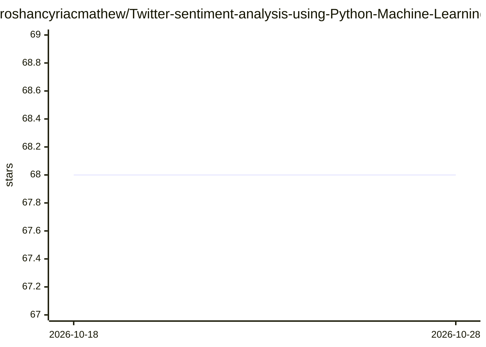

# roshancyriacmathew/Twitter-sentiment-analysis-using-Python-Machine-Learning-Project-8

⭐ 68 · Jupyter Notebook · 推送 2026-07-26 · [GitHub](https://github.com/roshancyriacmathew/Twitter-sentiment-analysis-using-Python-Machine-Learning-Project-8) · 个人维护

**用 Python 对辉瑞疫苗推文做情感分析的教学项目**

机器学习教学项目：使用 Kaggle 上的辉瑞疫苗相关推文数据，训练分类模型将推文区分为正面、负面、中性三种情感，并尝试多种分类器比较模型准确率。面向学习机器学习与 Python 的开发者，配套 YouTube 视频讲解。README 未给出安装命令或运行说明。

## 筛选速览

| 维度 | 判定 | 备注 |
|---|---|---|
| AI 角色 | `ai-native` | 本体是模型或模型工具 |
| 许可风险 | `none` | — |
| 部署形态 | `None` |  |
| 模型依赖 | — | README 未给出锁定关系 |
| 硬件要求 | — | 无带数字的原话,不猜 |
| 安装摩擦 | `low` | 无编译、无系统依赖或容器化 |
| 成熟度 | — | 结构信号不足 |

## 能力要点

- 基于 Kaggle 辉瑞疫苗推文数据构建情感分类模型
- 识别正面/负面/中性三类情感
- 对比多种分类器的准确率

## 适用场景

- 学习用 Python 做文本情感分析
- 了解多分类器对比的建模流程
- 作为推文情感分析项目的入门示例

## 场景标签

`教程课程` · 领域:学习与行业

## 证据(README 行号)

> L2: This project walks you on how to create a twitter sentiment analysis model using python. Twitter sentiment analysis 

## 星数曲线

2026-10-18 68 → 2026-10-28 68（+0）

---
*卡片 v1 · prompt 1.4 · 生成 2026-10-24 · 置信度 mid · 依据 README sha `a92fe7d160bd` · [字段定义](../../DATASET.md)*
