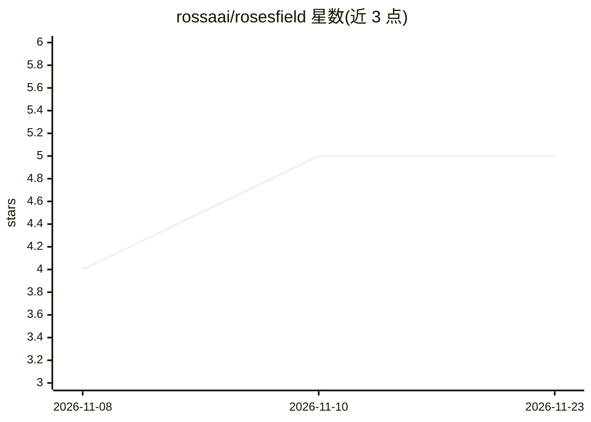

# rossaai/rosesfield

⭐ 5 · TypeScript · MIT · 推送 2026-11-05 · [GitHub](https://github.com/rossaai/rosesfield) · [官网](https://rosesfield.com) · 个人维护

**基于 ComfyUI 的开源 Higgsfield 替代品，25+ 生成应用**

用 ComfyUI 构建的生成式媒体应用集合，覆盖图像、视频、音频与 3D 共 25+ 个应用，内部对应 30+ 个 ComfyUI 工作流。运行需要用户自备 Comfy key，按次消耗 Comfy 账户积分；任务可在 Comfy Router、Comfy Cloud 或本机 ComfyUI（经 comfy-api-proxy）执行。入口包括网页应用（可安装到手机）、MCP 服务器（每应用一个工具）、HTTP API（每应用一个路由）以及代为执行应用的 agent。宿主支持本机 bun 或 Cloudflare Workers，MIT 许可。

## 筛选速览

| 维度 | 判定 | 备注 |
|---|---|---|
| AI 角色 | `ai-native` | 本体是模型或模型工具 |
| 许可风险 | `permissive` | MIT |
| 部署形态 | `None` |  |
| 模型依赖 | — | README 未给出锁定关系 |
| 硬件要求 | — | 无带数字的原话,不猜 |
| 安装摩擦 | `medium` | 含编译或系统依赖之一 |
| 成熟度 | — | 结构信号不足 |

## 能力要点

- 25+ 应用对应 30+ 个可打开编辑的 ComfyUI 工作流文件
- 四种入口：网页应用、MCP 服务器、HTTP API、执行应用的 agent
- 一个 Comfy key 即登录，运行消耗用户自己的 Comfy 积分
- 可在本机 ComfyUI 上运行开放权重工作流（comfy-api-proxy）

## 适用场景

- 用自己的 Comfy key 生成图像、视频、语音、音乐与 3D 模型
- 通过 MCP 把生成应用接入 Claude、ChatGPT 等客户端
- 在本地 GPU 上的自有 ComfyUI 中运行开放权重工作流
- 通过 HTTP API 将单个生成应用作为路由集成到其他系统

## 场景标签

`图像生成` `视频生成` `语音合成` · 领域:内容生成

## 证据(README 行号)

> L63: |ComfyUI workflows|30+ graphs. All but one load open weights, and one runs Comfy's Meshy partner node. Each is an A
> L65: |Where a run happens|Comfy Router, Comfy Cloud, or your own ComfyUI through comfy-api-proxy|
> L67: |Ways in|the web app, installable on a phone, an MCP server with one tool per app, an HTTP API with one route per a

## 星数曲线

2026-11-08 4 → 2026-11-23 5（+1）

---
*卡片 v1 · prompt 1.4 · 生成 2026-11-22 · 置信度 high · 依据 README sha `40c442a6e514` · [字段定义](../../DATASET.md)*
