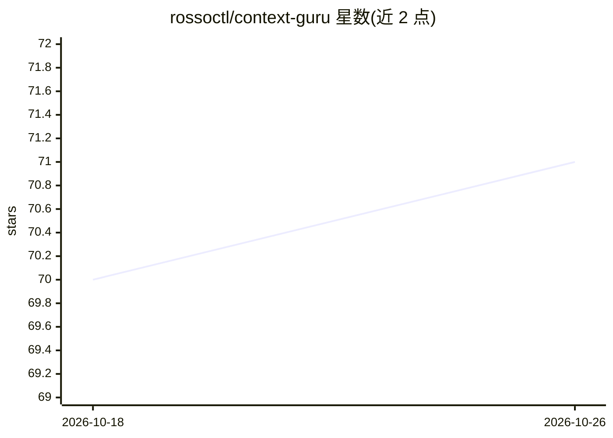

# rossoctl/context-guru

⭐ 71 · Go · Apache-2.0 · 推送 2026-10-25 · [GitHub](https://github.com/rossoctl/context-guru) · [官网](https://rossoctl.github.io/context-guru/) · 组织维护

**AI 编码 agent 的上下文工程代理：降低 token 成本与延迟**

面向 Claude Code 与 Codex 的 provider 无关上下文优化工具，以代理二进制加插件形式安装。通过削减冗余工具输出、折叠被取代的运行、在临近上限前做摘要来少带上下文，并通过保持提示缓存热度、分离系统提示中的易变尾部来降低所携带内容的成本。提供 off/conservative/medium/high/xhigh 五档预设，其中 medium 及以上引入模型调用做相关性过滤与摘要。状态行实时显示节省金额、缓存时钟与上下文占用，并提供 insights 命令、仪表盘与历史回放调参。Codex 支持标注为实验性。

## 筛选速览

| 维度 | 判定 | 备注 |
|---|---|---|
| AI 角色 | `ai-ecosystem` | LLM/agent 周边工具 |
| 许可风险 | `permissive` | Apache-2.0 |
| 部署形态 | `None` |  |
| 模型依赖 | — | README 未给出锁定关系 |
| 硬件要求 | — | 无带数字的原话,不猜 |
| 安装摩擦 | `low` | 无编译、无系统依赖或容器化 |
| 成熟度 | `idea` | |

## 能力要点

- 代理层削减冗余工具输出并在近上限时摘要旧轮次
- 保持提示缓存热度并分离系统提示易变尾部，默认开启
- off/conservative/medium/high/xhigh 五档预设，可随时切换
- 状态行实时显示节省金额，/context-guru:insights 输出成本分析

## 适用场景

- 降低 Claude Code 或 Codex 编码会话的 API 费用
- 分析哪些 MCP 服务器与技能从未使用以精简工具集
- 回放历史会话找到成本最低的配置
- 监控提示缓存命中与上下文占用情况

## 场景标签

`LLM 可观测性` · 领域:评测与运维

## 证据(README 行号)

> L5: **Provider-agnostic context engineering for LLM agents.**
> L14: context-guru cuts the token cost of your agent's traffic in two ways: **carry less context**
> L16: **pay less for what you still carry** (keep your prompt cache warm, split the volatile tail off

## 星数曲线

2026-10-18 70 → 2026-10-26 71（+1）

---
*卡片 v1 · prompt 1.4 · 生成 2026-10-24 · 置信度 high · 依据 README sha `ff59911be324` · [字段定义](../../DATASET.md)*
