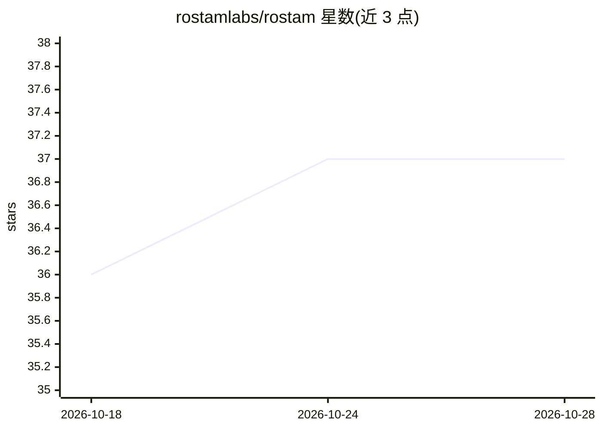

# rostamlabs/rostam

⭐ 37 · Go · Apache-2.0 · 推送 2026-09-27 · [GitHub](https://github.com/rostamlabs/rostam) · [官网](https://docs.rostamlabs.com/) · 组织维护

**Go 实现的向量数据库+键值存储引擎，含 MCP/RAG/LLM 缓存代理**

单一 Go 引擎提供向量搜索（HNSW/IVF/Vamana 索引、SQ8/binary/PQ 量化、稠密+稀疏混合与 BM25 检索）与键值存储（含沙箱 WASM 存储过程），可作独立服务器（REST/gRPC/二进制 TCP）、Raft 复制集群或嵌入式库运行。面向开发者与需要低延迟检索/缓存的系统。附三个上层工具：MCP stdio 服务器（供 Claude Code 等客户端持久记忆）、OpenAI 兼容 LLM 缓存反向代理、RAG CLI。内置纯 Go 本地嵌入（rembed）。自述为 Beta，1.0 前 API 可能变动。

## 筛选速览

| 维度 | 判定 | 备注 |
|---|---|---|
| AI 角色 | `ai-ecosystem` | LLM/agent 周边工具 |
| 许可风险 | `permissive` | Apache-2.0 |
| 部署形态 | `self-host` | docker 或自建部署 |
| 模型依赖 | — | README 未给出锁定关系 |
| 硬件要求 | — | 无带数字的原话,不猜 |
| 安装摩擦 | `low` | 无编译、无系统依赖或容器化 |
| 成熟度 | `idea` | |

## 能力要点

- HNSW/IVF/Vamana 索引与 SQ8/binary/PQ 量化，稠密+稀疏混合与 BM25 检索
- 三种运行形态：独立服务器 / 分片 Raft 集群（在线重分片、S3 备份、RBAC/JWT/mTLS）/ 嵌入式 Go 库（无需 cgo）
- rostam-server mcp 提供 MCP 工具与持久 agent 记忆，默认 BM25 无需嵌入 API key
- OpenAI 兼容 LLM 缓存代理与开箱即用 RAG CLI（文档摄取+带引用回答）
- 键值引擎支持沙箱 WASM 存储过程（纯 Go 构建除外）

## 适用场景

- 为应用提供可嵌入或集群部署的低延迟向量检索与键值存储
- 给 Claude Code/Cursor 等 MCP 客户端接入持久 agent 记忆
- 在本地语义缓存重复的 LLM 请求以减少上游 API 调用
- 用一条命令对文档目录建索引并做带引用的问答

## 场景标签

`向量数据库` `Agent 记忆` `RAG` · 领域:Agent 开发

## 证据(README 行号)

> L7: **A high-performance vector database and sub-microsecond key-value store in a
> L25: `rostam-server mcp` runs Rostam as an MCP
> L41: `rostam-server llm-proxy` is an OpenAI-compatible caching reverse proxy:
> L58: `rostam-server rag` chunks and indexes your documents, then answers

## 星数曲线

2026-10-18 36 → 2026-10-28 37（+1）

---
*卡片 v1 · prompt 1.4 · 生成 2026-10-25 · 置信度 high · 依据 README sha `7e3c0767cb1f` · [字段定义](../../DATASET.md)*
