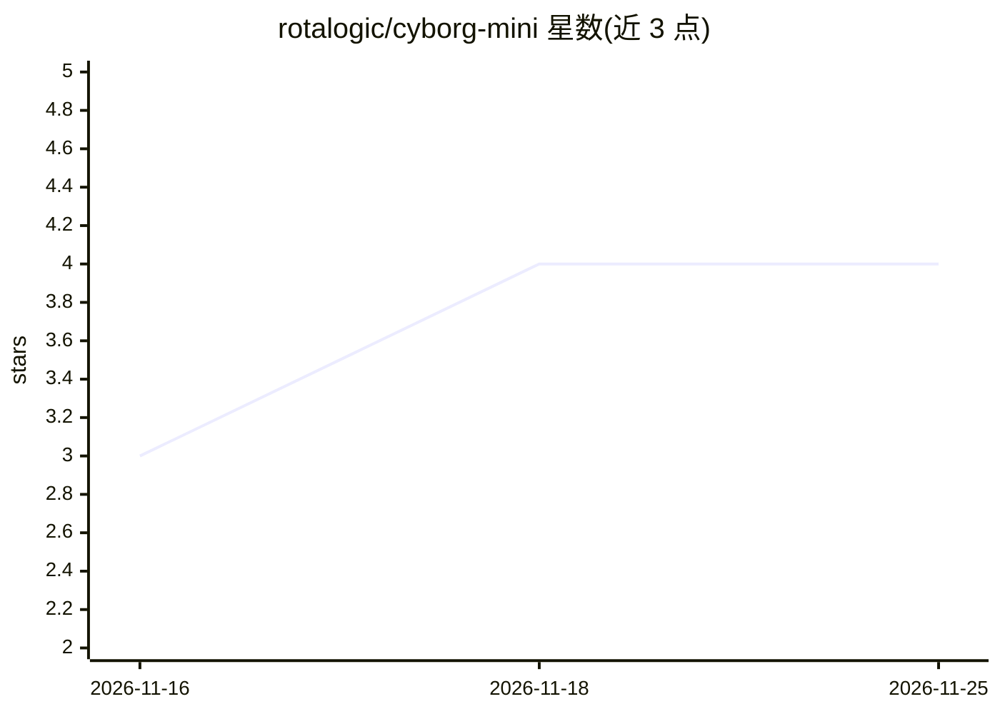

# rotalogic/cyborg-mini

⭐ 4 · NOASSERTION · 推送 2026-11-16 · [GitHub](https://github.com/rotalogic/cyborg-mini) · 个人维护

**单文件 AI 技能：为个人提供结构化思考与目标管理工作流**

一个单文件提示词技能（SKILL.md / MASTER-PROMPT.md），粘贴到任意能读取指令的 AI 聊天中激活，或作为常驻技能安装到支持的助手平台。功能包括 Brain Inbox 捕捉想法、最多 3 个活跃目标、每个任务一个下一步行动、Fact→Evidence→Pattern→Hypothesis→Validation→Conclusion 的推理管线、教学模式的 5 步协议，以及一致性检查与经验记录。README 明确说明它不改变模型权重，仅为会话期的行为指令层。许可证为专有（Proprietary），公开可见仅供评估，非开源。

## 筛选速览

| 维度 | 判定 | 备注 |
|---|---|---|
| AI 角色 | `ai-knowledge` | 知识聚合/清单类 |
| 许可风险 | `none` | NOASSERTION |
| 部署形态 | `None` |  |
| 模型依赖 | — | README 未给出锁定关系 |
| 硬件要求 | — | 无带数字的原话,不猜 |
| 安装摩擦 | `low` | 无编译、无系统依赖或容器化 |
| 成熟度 | — | 结构信号不足 |

## 能力要点

- Master Prompt 粘贴即激活，适用于任意聊天 AI
- SKILL.md 单文件包含完整规则，可作常驻技能安装
- Brain Inbox / 目标上限 3 个 / 每任务一个下一步行动的工作流
- Teaching Mode 用用户自己的问题教授思考模式

## 适用场景

- 把散乱想法集中捕捉并分类管理
- 在 AI 协助下做有可追溯理由的决策
- 用教学模式练习结构化思考方法
- 维护个人目标与每日聚焦事项

## 场景标签

`提示工程` `知识库管理` · 领域:Agent 开发

## 证据(README 行号)

> L8: CYBORG Mini is a single-file, portable skill that teaches an AI assistant — and its user — to think more clearly and
> L10: It works on any AI that can read instructions: paste the Master Prompt into a chat (ChatGPT, Claude, Gemini, and ot
> L14: CYBORG Mini does **not** retrain or change an AI model's weights, and it does not make a model permanently smarter.

## 星数曲线

2026-11-16 3 → 2026-11-25 4（+1）

---
*卡片 v1 · prompt 1.4 · 生成 2026-11-21 · 置信度 high · 依据 README sha `869939434fe1` · [字段定义](../../DATASET.md)*
