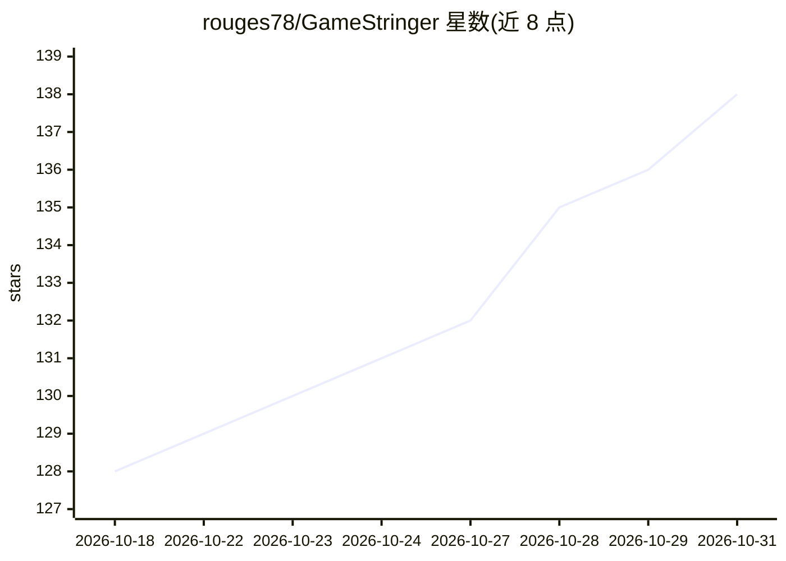

# rouges78/GameStringer

⭐ 138 · TypeScript · NOASSERTION · 推送 2026-10-26 · [GitHub](https://github.com/rouges78/GameStringer) · [官网](https://gamestringer.ai) · 个人维护

**桌面应用：自动检测游戏引擎，用 AI 翻译游戏文本并打回补丁**

面向玩家的 Windows/macOS/Linux 桌面应用，用于翻译没有本地化版本的单机游戏：自动扫描游戏库、检测引擎（专用解析器 12 个、可识别 20+），提取文本后经用户选择的 AI 提供商（OpenAI、Claude、Gemini、DeepSeek、Ollama 等 20+）翻译，再打回游戏文件并自动备份。翻译前可运行预测工具 P.T. 输出难度评分、耗时估计与推荐 LLM 链，并检测 DRM 与编码。Unity 游戏通过自动安装 BepInEx 做运行时注入。单人维护、source-available，作者自述项目仍处于早期，请求社区实测反馈。

## 筛选速览

| 维度 | 判定 | 备注 |
|---|---|---|
| AI 角色 | `ai-native` | 本体是模型或模型工具 |
| 许可风险 | `none` | NOASSERTION |
| 部署形态 | `desktop` | 安装包/桌面程序 |
| 模型依赖 | local-ok | 支持本地模型 |
| 硬件要求 | — | 无带数字的原话,不猜 |
| 安装摩擦 | `low` | 无编译、无系统依赖或容器化 |
| 成熟度 | `idea` | |

## 能力要点

- 完整流水线：扫描→引擎检测→文本提取→AI 翻译→质检→打回补丁
- P.T. 预测工具：0–100 难度评分、18 个 LLM 模型耗时估计、DRM/编码检测
- 20+ AI 提供商可选（含 Ollama 本地模型），12 引擎专用解析器、识别 20+ 引擎
- Unity 游戏自动安装 BepInEx + XUnity.AutoTranslator，无需手动配置

## 适用场景

- 把没有官方本地化的游戏翻译成我的语言
- 翻译前先评估游戏文本量、难度和 DRM 风险
- 用本地模型（Ollama）离线翻译游戏文本
- 在 Patch Hub 分享或下载现成翻译包

## 场景标签

`AI 写作` · 领域:内容生成

## 证据(README 行号)

> L6:  Desktop app that translates video games into any language using AI.
> L81: Most games store their text in files — JSON, XML, CSV, `.locres`, `.rpy`, BSA/BA2, CPK, Unity Localization StringTa

## 星数曲线

2026-10-18 128 → 2026-10-31 138（+10）

---
*卡片 v1 · prompt 1.4 · 生成 2026-10-22 · 置信度 high · 依据 README sha `55e7d37d2387` · [字段定义](../../DATASET.md)*
