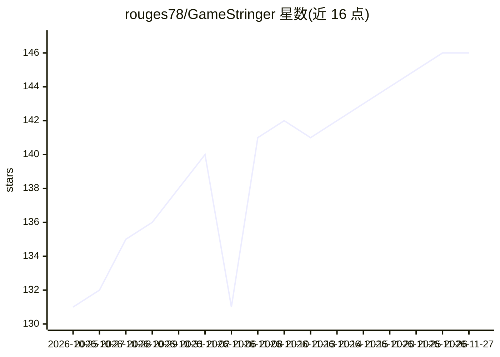

# rouges78/GameStringer

⭐ 146 · TypeScript · NOASSERTION · 推送 2026-11-26 · [GitHub](https://github.com/rouges78/GameStringer) · [官网](https://gamestringer.ai) · 个人维护

**面向玩家的游戏文本 AI 翻译桌面应用**

桌面应用（Windows/macOS/Linux），自动检测游戏引擎，扫描游戏文件夹中的文本文件（JSON/XML/.locres/.rpy/BSA/CPK 等），交由用户选择的 AI 翻译服务翻译后回写补丁，回写前自动备份。内置 P.T. 预估工具（难度评分、18 个 LLM 模型耗时预估、DRM 与编码检测）、Dry Run 批量扫描与 Patch Hub 补丁分享。支持 20+ 引擎（12 个专用解析器），Windows 独占运行时注入翻译。单人维护的 source-available 项目，安装包经签名分发。

## 筛选速览

| 维度 | 判定 | 备注 |
|---|---|---|
| AI 角色 | `ai-native` | 本体是模型或模型工具 |
| 许可风险 | `none` | NOASSERTION |
| 部署形态 | `desktop` | 安装包/桌面程序 |
| 模型依赖 | local-ok | 支持本地模型 |
| 硬件要求 | — | 无带数字的原话,不猜 |
| 安装摩擦 | `low` | 无编译、无系统依赖或容器化 |
| 成熟度 | `idea` | |

## 能力要点

- 自动检测 20+ 游戏引擎，12 个带专用文本解析器
- 扫描-提取-AI 翻译-回写补丁的完整流水线，补丁前自动备份
- P.T. 预估工具：难度评分、耗时估算、DRM/编码检测
- 支持 OpenAI、Claude、Gemini、DeepSeek、Ollama 等 20+ 翻译服务

## 适用场景

- 把不含我语言的单机游戏文本翻译成本地语言
- 用 P.T. 先评估游戏翻译难度和 DRM 风险再动手
- 在 Patch Hub 下载或分享已完成的翻译补丁

## 场景标签

 · 领域:游戏工具/本地化

## 证据(README 行号)

> L6:  Desktop app that translates video games into any language using AI.
> L81: Most games store their text in files — JSON, XML, CSV, `.locres`, `.rpy`, BSA/BA2, CPK, Unity Localization StringTa
> L104: **Requirements:** Windows 10+, macOS 10.15+, or Linux (Ubuntu 22.04+, Fedora 38+). 4 GB RAM (8 GB+ for local AI), 

## 星数曲线

2026-10-25 131 → 2026-11-27 146（+15）

---
*卡片 v1 · prompt 1.4 · 生成 2026-11-27 · 置信度 mid · 依据 README sha `aee7c1ce0156` · [字段定义](../../DATASET.md)*
