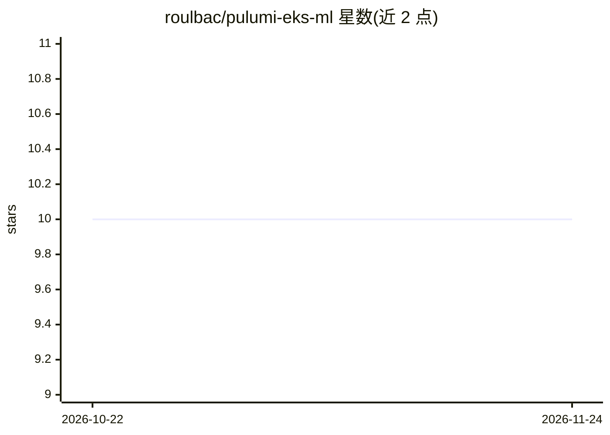

# roulbac/pulumi-eks-ml

⭐ 10 · Python · MIT · 推送 2026-08-09 · [GitHub](https://github.com/roulbac/pulumi-eks-ml) · 个人维护

**在 AWS 上搭建多租户多区域 ML 平台的 Pulumi 组件库**

以 Python 编写的 Pulumi 模块化基础设施库，将 VPC、EKS 集群、GPU 节点池等封装为可组合构建块，通过 Pulumi stacks 在多环境间部署同一拓扑。内置 Karpenter 自动伸缩、NVIDIA GPU 驱动、ALB/EBS/EFS 等插件，支持跨区域 Full Mesh/Hub-and-Spoke VPC 对等网络与 Tailscale VPN，并提供 SkyPilot 多租户部署方案。附 starter、multi-region、skypilot-multi-tenant 三个参考工程与单元/集成测试。需 Pulumi CLI、Python 3.12+ 与 AWS 环境。

## 筛选速览

| 维度 | 判定 | 备注 |
|---|---|---|
| AI 角色 | `ai-ecosystem` | LLM/agent 周边工具 |
| 许可风险 | `permissive` | MIT |
| 部署形态 | `None` |  |
| 模型依赖 | — | README 未给出锁定关系 |
| 硬件要求 | — | 无带数字的原话,不猜 |
| 安装摩擦 | `low` | 无编译、无系统依赖或容器化 |
| 成熟度 | — | 结构信号不足 |

## 能力要点

- 模块化 Pulumi 组件：VPC、EKS、GPU 节点池可自由组装
- Karpenter 自动伸缩（Spot/On-Demand）并预配 NVIDIA GPU 驱动
- 多区域 Full Mesh / Hub-and-Spoke VPC 对等拓扑与 Tailscale VPN
- SkyPilot 多租户多区域平台，含 Cognito 认证与隔离数据平面

## 适用场景

- 在 AWS 上快速拉起单区域 EKS 集群跑 ML 工作负载
- 为多个团队部署隔离的多租户 AI 训练/推理平台
- 用 Python 定义一次拓扑，在多环境复制相同基础设施

## 场景标签

 · 领域:云计算/ML 基础设施

## 证据(README 行号)

> L5: **An opinionated library for multi-tenant, multi-region Machine Learning platforms on AWS.**
> L7: This repository provides a modular set of Pulumi components (`pulumi_eks_ml`) to spin up multi-tenant, multi-region 
> L44: - **ML-Optimized Compute**: Pre-configured EKS clusters with **Karpenter** for autoscaling (Spot/On-Demand) and NVI

## 星数曲线

2026-10-22 10 → 2026-11-24 10（+0）

---
*卡片 v1 · prompt 1.4 · 生成 2026-11-19 · 置信度 high · 依据 README sha `3830b798bef2` · [字段定义](../../DATASET.md)*
