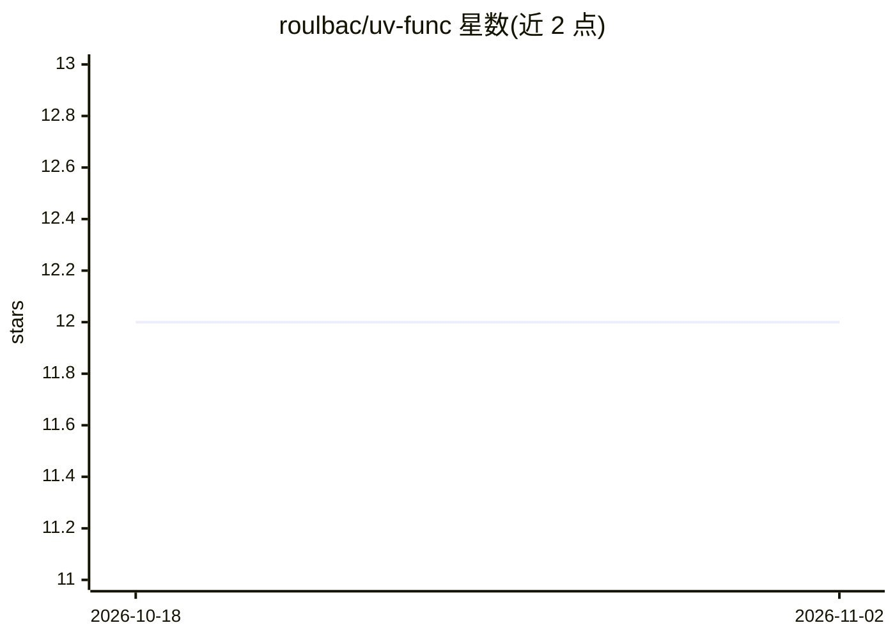

# roulbac/uv-func

⭐ 12 · Python · MIT · 推送 2026-03-11 · [GitHub](https://github.com/roulbac/uv-func) · 个人维护

**Python 装饰器：让单个函数在独立 uv 虚拟环境中运行**

以装饰器形式将 Python 函数放入由 uv 引导的隔离虚拟环境执行：开发者声明每个函数自己的依赖列表（如不同版本的 torch/numpy），库按依赖哈希创建或复用环境，用 cloudpickle 序列化函数与参数后在子进程中执行，并把结果传回父进程。面向需要解决同一程序内依赖冲突或按需引入重型库的开发者。限制：输入输出与返回值必须可被 cloudpickle 序列化，复杂对象、文件句柄、数据库连接不可用。需 Python 3.12+ 与 uv 包管理器。

## 筛选速览

| 维度 | 判定 | 备注 |
|---|---|---|
| AI 角色 | `ai-enhanced` | 去掉 AI 部分产品仍成立 |
| 许可风险 | `permissive` | MIT |
| 部署形态 | `library` | 以包/库形式分发 |
| 模型依赖 | — | README 未给出锁定关系 |
| 硬件要求 | — | 无带数字的原话,不猜 |
| 安装摩擦 | `low` | 无编译、无系统依赖或容器化 |
| 成熟度 | — | 结构信号不足 |

## 能力要点

- 函数级依赖隔离，装饰器声明依赖列表
- 按依赖哈希缓存并复用虚拟环境
- cloudpickle 序列化后在子进程执行，实时流式输出 stdout/stderr
- 异常带 traceback 完整传播，线程安全

## 适用场景

- 同一程序中使用不同版本的同一库
- 仅在个别函数中按需引入 PyTorch/TensorFlow 等重型依赖
- 避免依赖冲突的轻量数据处理管线

## 场景标签

 · 领域:Python 开发工具

## 证据(README 行号)

> L6: Run Python functions in isolated UV virtual environments with their own dependencies – like `uv run` for individual 
> L10: **Problem:** Need different library versions in the same program? Want to use heavy dependencies (PyTorch, TensorFl

## 星数曲线

2026-10-18 12 → 2026-11-02 12（+0）

---
*卡片 v1 · prompt 1.4 · 生成 2026-11-01 · 置信度 low · 依据 README sha `e24a48c22197` · [字段定义](../../DATASET.md)*
