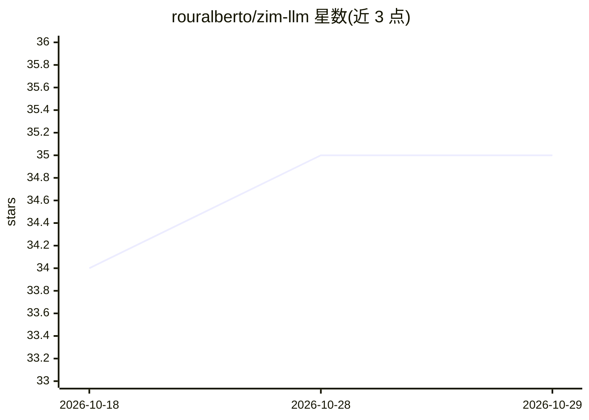

# rouralberto/zim-llm

⭐ 35 · Python · 推送 2026-10-16 · [GitHub](https://github.com/rouralberto/zim-llm) · [官网](https://albertoroura.com/building-an-offline-knowledge-base-with-zim-and-docker-model-runner/) · 个人维护

**将 Kiwix ZIM 离线档案转为向量库并做 RAG 问答的工具**

读取 Kiwix 的 ZIM 压缩档案（Wikipedia/Stack Exchange/文档镜像），经 HTML 清洗与分块后写入 ChromaDB 或 FAISS 向量库，配合本地或远程 LLM 提供带引用的检索问答，面向需要在低配设备、无网络环境下拥有百科式知识库的用户。LLM 后端默认 Docker Model Runner，可选 Ollama、OpenAI 兼容服务、OpenAI 与 Anthropic；构建过程可断点续跑、内存恒定。限制：首次构建大型 ZIM（2GB+）可能耗时数小时，切换嵌入模型需重建数据库。

## 筛选速览

| 维度 | 判定 | 备注 |
|---|---|---|
| AI 角色 | `ai-native` | 本体是模型或模型工具 |
| 许可风险 | `none` | — |
| 部署形态 | `library` | 以包/库形式分发 |
| 模型依赖 | local-ok | 支持本地模型 |
| 硬件要求 | — | 无带数字的原话,不猜 |
| 安装摩擦 | `medium` | 含编译或系统依赖之一 |
| 成熟度 | — | 结构信号不足 |

## 能力要点

- 动态发现库目录中的 ZIM 文件并增量索引，构建可断点续跑
- ChromaDB / FAISS 两种向量库可选
- 回答附编号引用，标注来源文章标题与 ZIM 文件
- 支持 Docker Model Runner / Ollama / OpenAI 兼容服务 / Anthropic 多种 LLM 后端

## 适用场景

- 离线环境下用 Wikipedia 等 ZIM 档案做带引用的知识问答
- 低配电脑上运行本地 LLM 的百科知识助手
- 批量导出 ZIM 档案的清洗文本用于分析

## 场景标签

`RAG` `文档问答` · 领域:知识与检索

## 证据(README 行号)

> L2: This project turns ZIM files (the compressed offline Wikipedia/Stack Exchange/docs archives from Kiwix) into a vecto
> L20: - **RAG with citations**: Answers cite numbered excerpts, and each excerpt shows its article title and source ZIM f

## 星数曲线

2026-10-18 34 → 2026-10-29 35（+1）

---
*卡片 v1 · prompt 1.4 · 生成 2026-10-25 · 置信度 mid · 依据 README sha `2c7b95707bb1` · [字段定义](../../DATASET.md)*
